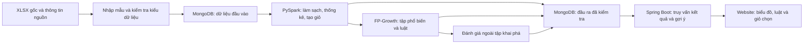

# Tư vấn kỹ thuật và chuẩn bị kiến thức

**Ngày đối chiếu nguồn và cập nhật: 13/10/2026.** Vai trò: Technical Advisor và Research Analyst. Tài liệu này ghi nhận lựa chọn mới **U-09: PySpark local + FP-Growth + MongoDB + Spring Boot**, thay khuyến nghị Parquet + Streamlit trước đó. Giữ nguyên các dòng yêu cầu nguồn và rubric của [Requirements Matrix](01_REQUIREMENT_MATRIX.md); chỉ cập nhật cách áp dụng theo [phạm vi đã xác nhận](07_CONFIRMED_SCOPE.md). Không phải kế hoạch triển khai toàn bộ dự án.

## 1. Căn cứ và cách hiểu kết quả tư vấn

Đề tài đã duyệt: **Phân tích hành vi mua sắm và gợi ý sản phẩm mua kèm**, nhóm hai người. Phải có website demo; trọng tâm xử lý/phân tích dữ liệu. Điều kiện: miễn phí, Windows 11, máy được mô tả có RAM 16 GB và trống vài chục GB; local được phép, không có ngưỡng dataset tối thiểu; nộp một lần cuối.

RTM được đọc cùng bảng điều chỉnh áp dụng ở đầu: B-H08–B-H09 thuộc nội dung đề tài đã chọn; B-H02–B-H06 vẫn là gợi ý công nghệ/kỹ thuật. Chọn đề tài không tự biến HDFS/MongoDB, Spark và FP-Growth thành một stack bắt buộc của giảng viên. Theo U-09, nhóm đã chọn PySpark local, FP-Growth, MongoDB và Spring Boot; tư vấn đánh giá lựa chọn này phù hợp. Spring MVC + Thymeleaf và cách chọn giỏ đã chốt theo U-11/U-12. Bố cục chi tiết, schema và phiên bản còn cần thiết kế/kiểm chứng; cả hai máy cần demo theo U-15. B-G07 về công nghệ Big Data, B-V01–B-V05 về đánh giá và B-P17 về duyệt dataset vẫn giữ.

**Điều đã biết về năng lực theo U-13:** cả hai đã học Java/Spring Boot, Python, MongoDB, HTML/CSS và chưa học Spark; chấp nhận AI hỗ trợ. “Đã học” không chứng minh thành thạo. **Điều chưa biết:** năng lực thực hành/thống kê/khai phá cụ thể, số giờ mỗi tuần (U-14), hạn nộp và cấu hình máy thứ hai. Cả hai cần demo U-15; không cam kết lịch hoặc suy PASS từ một máy sang máy kia.

U-16–U-18 đã chốt P-01/P-02/P-03, P-01 chỉ giữ dòng đầu. Đọc nhanh tại [khảo sát dữ liệu và audit chính sách](10_DATASET_PROFILE.md), [đặc tả hiện tại](11_SPECIFICATION_DRAFT.md) và [thiết kế đề xuất](12_TECHNICAL_DESIGN.md); không cần đọc lại toàn bộ tư vấn để trả lời các lựa chọn đã chốt.

Các mã KG, SOL, RISK, EXP, SRC trong tài liệu này chỉ là mã tổ chức tư vấn, **không phải Requirement ID mới**. Tiêu chí cho thử nghiệm nhỏ là đề xuất kiểm chứng kỹ thuật, không phải tiêu chí chấm hoặc ngưỡng nghiệm thu mới.

## 2. Knowledge Gap Analysis

Ba mức học:

- **Sâu:** tự giải thích cơ chế, tính một ví dụ nhỏ và nhận ra trường hợp kết quả sai hoặc bị diễn giải quá mức. Không nhất thiết tự viết lại thuật toán/thư viện.
- **Đủ triển khai:** đọc tài liệu, sử dụng đúng, kiểm tra đầu ra và xử lý lỗi thường gặp của thành phần đã chọn.
- **Tham khảo:** hiểu vai trò/giới hạn để so sánh và phản biện; chưa cần cài đặt hay học toàn bộ hệ sinh thái.

Trong cột nguồn học, SRC trỏ tới danh sách có liên kết chính thức ở phần 5. Liên kết Requirement ID được đối chiếu với RTM, không suy ra trọng số cho từng nhóm kiến thức.

| ID | Nhóm kiến thức và mức cần đạt | Requirement ID liên quan | Nội dung cần hiểu / khoảng trống cần kiểm tra | Dấu hiệu đã hiểu đủ để bước tiếp | Nguồn học |
| --- | --- | --- | --- | --- | --- |
| KG-01 | Bài toán mua kèm — **Sâu** | B-S01–B-S07; B-H08–B-H09; U-01/U-03 | Phân tích hóa đơn khác theo dõi click/xem trang; mua cùng trong một giỏ khác mua lại hoặc cá nhân hóa theo lịch sử. Xác định người xem dashboard và ý nghĩa đầu ra. | Giải thích được gợi ý cho giỏ đang chọn và giới hạn kết luận từ dữ liệu giao dịch. Không hứa tăng doanh thu khi chưa đo. | SRC-01, SRC-06 |
| KG-02 | Schema và đơn vị phân tích — **Sâu** | B-D04–B-D06; B-D15; B-P19; B-E05 | Phân biệt dòng hàng, hóa đơn/giỏ, sản phẩm, khách hàng. Kiểm tra khóa hóa đơn qua các sheet/thời kỳ; bảo toàn mã dạng chuỗi; thời gian/đơn vị tiền. | Từ một hóa đơn nhiều dòng, tạo được tập sản phẩm duy nhất và giải thích vì sao số dòng không phải số giỏ. | SRC-01, SRC-04, SRC-09 |
| KG-03 | Chất lượng dữ liệu — **Sâu** | B-D08–B-D14; B-P27 | Thiếu CustomerID có thể vẫn dùng cho giỏ nhưng không cho chỉ số khách hàng; hủy/đổi trả khác mua hợp lệ; ngoại lệ bán buôn không mặc nhiên là lỗi; lặp sản phẩm khác lặp sai bản ghi. | Với mỗi loại lỗi, nêu kiểm tra, quyết định giữ/sửa/loại và ảnh hưởng số giỏ/chỉ số. Không xóa theo cảm tính. | SRC-01, SRC-04, SRC-09 |
| KG-04 | Thống kê và diễn giải — **Sâu** | B-H08; B-F02; B-V02/B-V04/B-V05 | Tần suất theo giỏ khác số lượng bán; trung bình khác phân phối; giá trị bán gộp khác doanh thu sau trả hàng. Hiểu mẫu số, thời kỳ và dữ liệu bị loại. | Tự tính vài hóa đơn rồi đối chiếu tổng hợp; mỗi biểu đồ có câu hỏi và mẫu số rõ. | SRC-01, SRC-04 |
| KG-05 | Tập phổ biến, luật kết hợp, FP-Growth — **Sâu** | B-T06; B-H05–B-H06; B-P10–B-P12; B-E03 | Tập sản phẩm, support, confidence, lift; chiều luật; tiền đề nhiều sản phẩm. Hiểu FP-tree chia sẻ tiền tố và khai phá điều kiện; phân biệt khai phá tập phổ biến với tạo luật/gợi ý. | Tính đúng ví dụ phần 3; giải thích được confidence cao nhưng lift thấp. Trình bày cơ chế bằng ví dụ, không cần tự cài FP-Growth. | SRC-05, SRC-06 |
| KG-06 | Nguyên lý Spark và Big Data — **Sâu ở cơ chế dùng** | B-G07; B-D03/B-D07; B-T02–B-T05; B-H03–B-H04 | Driver, task/partition, transformation/action, thực thi trì hoãn và shuffle; local chạy nhiều tác vụ trên một máy khác cluster nhiều máy. | Chỉ ra bước gom hóa đơn cần trao đổi dữ liệu, vì sao không tải toàn bộ về Python; giải thích lợi ích và chi phí của Spark ở quy mô thật. | SRC-03, SRC-04, SRC-08 |
| KG-07 | Đánh giá và so sánh — **Sâu** | B-V01–B-V05; B-P13–B-P14; B-E03–B-E06 | Luật có chỉ số tốt chưa chứng minh gợi ý tốt. Chia dữ liệu tránh rò rỉ; tạo giỏ truy vấn và sản phẩm ẩn; baseline cùng điều kiện; xử lý giỏ không có luật. | Phác thảo được phép đánh giá có dữ liệu ngoài tập khai phá; giải thích độ đúng, độ phủ và giới hạn offline. | SRC-07, SRC-06 |
| KG-08 | Python cho dữ liệu — **Đủ triển khai** | B-E01–B-E02; B-O01/B-O05/B-O06; U-09/SOL-05 | Hàm/module, list/set/dict, kiểu và null, ngoại lệ, nhập XLSX, môi trường ảo và phụ thuộc; Python vẫn phục vụ job PySpark dù web dùng Java. | Đọc được quy trình biến đổi và chỉ ra lỗi kiểu; phân biệt môi trường Python với Java runtime và dữ liệu trao đổi qua MongoDB. | SRC-02, SRC-10 |
| KG-09 | Spark SQL/DataFrame — **Đủ triển khai** | B-D09/B-D10/B-D15; B-T02; B-H03–B-H04; B-E02 | Schema tường minh, lọc/ép kiểu, group/join, tập sản phẩm, đọc/ghi; biết khi nào action xảy ra. Ưu tiên hàm có sẵn trước UDF khi đáp ứng bài toán. | Có thể đối chiếu một kết quả gom giỏ với dữ liệu đầu vào nhỏ và kiểm tra số bản ghi bị mất khi join/lọc. | SRC-04 |
| KG-10 | MongoDB và nhập XLSX — **Đủ triển khai; sâu ở tính toàn vẹn dữ liệu** | B-T01/B-T04/B-T05; B-D04–B-D06; B-O02; B-H01–B-H02; U-09 | Document/collection/index, BSON, khóa và kiểu mã/ngày/tiền/null/array; đọc ghi qua connector và Java. Giữ file gốc; phân biệt dữ liệu nguồn với đầu ra tái tạo. XLSX cần bước nhập phù hợp. | Mẫu nhập rồi đọc qua Spark và Spring giữ đúng ý nghĩa; truy vấn có điều kiện và phân trang; không đóng toàn bộ dataset/luật vào một document. | SRC-09, SRC-10, SRC-12, SRC-15 |
| KG-11 | Biến luật thành gợi ý — **Đủ triển khai, hiểu sâu điều kiện áp dụng** | B-H09; B-F02; B-T06; B-V04 | Tiền đề phải có đủ trong giỏ; loại sản phẩm đã có, hợp nhất ứng viên trùng; xác định thứ tự và cách giải thích. Không nhầm confidence thành xác suất cá nhân chắc chắn sẽ mua. | Giỏ có A nhưng thiếu B không được áp dụng luật {A,B}→C. Khi không có luật, thể hiện đúng trạng thái; thứ tự gợi ý được đặc tả. | SRC-06 |
| KG-12 | Spring Boot, giao diện và trực quan hóa — **Đủ triển khai** | B-F01–B-F02; B-R07–B-R08; B-N03; U-03/U-09 | Spring MVC, Spring Data MongoDB, controller/template, biểu đồ, bộ lọc và trạng thái rỗng. Spring Boot cần phần giao diện để thành website demo; Spring MVC + Thymeleaf đã chọn theo U-12. | Website đọc kết quả batch đã có, không chạy lại FP-Growth khi lọc; áp dụng luật đầy đủ tiền đề; đầu vào được kiểm tra và UI dùng cùng phiên bản kết quả với báo cáo. | SRC-11, SRC-12 |
| KG-13 | Thực nghiệm có thể kiểm tra lại — **Đủ triển khai** | B-E01–B-E07; B-O05–B-O06; B-V03 | Ghi nguồn/phiên bản dữ liệu, môi trường, tham số và đầu ra; phân biệt thời gian đọc, làm sạch, khai phá, phục vụ web. Đo trước khi tối ưu. | Người còn lại chạy theo hướng dẫn và giải thích được chênh lệch; so sánh dùng cùng dữ liệu và điều kiện được ghi rõ. | SRC-02, SRC-03, SRC-08 |
| KG-14 | Báo cáo, nguồn học, phối hợp và phản biện — **Đủ triển khai** | B-R01–B-R12; B-O03–B-O08; B-N02–B-N07; B-P33–B-P39; B-A01–B-A04; B-L01–B-L07; A-F001–A-F067 | Dẫn nguồn thật; tách giả định, kết quả, đề xuất; Word Styles/caption/mục lục/đánh số trang; khai đóng góp. AI hỗ trợ không thay thế việc hiểu và kiểm tra sản phẩm. | Đối chiếu được mỗi kết quả với dữ liệu/tham số; cả hai giải thích luồng chung và phần mình làm. Không dùng mục lục/số trang mẫu như kết quả thật. | SRC-01, SRC-13; checklist 02/03 |
| KG-15 | HDFS, cluster và kỹ thuật khác — **Tham khảo** | B-H02; B-T01/B-T05/B-T06; U-05/U-09 | HDFS: block, NameNode/DataNode, replication; biết RDD, streaming, ALS có bài toán khác. MongoDB đã chuyển sang mức đủ triển khai ở KG-10 theo stack chọn. | Giải thích vì sao Spark local khác cluster nhiều máy; không học Kafka/YARN/Kubernetes chỉ vì tên môn Big Data. | SRC-14; MongoDB ở SRC-10/SRC-12/SRC-15 |

## 3. Các cơ chế cần nắm chắc

### 3.1. Từ giao dịch đến giỏ hàng

Đề xuất dùng định danh hóa đơn đã được kiểm tra làm khóa giỏ, mã sản phẩm làm item. Số lượng/giá dùng cho thống kê; FP-Growth chuẩn xét **sự hiện diện** của sản phẩm. Sản phẩm xuất hiện nhiều dòng trong một hóa đơn được quy về một item trong giỏ, nhưng dữ liệu dòng hàng dùng tính giá trị mua phải được xử lý theo nghiệp vụ riêng. Không xóa mất thông tin số lượng chỉ vì đầu vào thuật toán là tập hợp.

Online Retail II là dataset ưu tiên từ file 08. UCI mô tả hơn một triệu dòng, có mã hóa đơn, hàng hóa, thời điểm, giá/số lượng; có dữ liệu thiếu và hóa đơn hủy. Cần kiểm tra file thực tế trước khi chốt schema, khóa và chính sách làm sạch. Dataset lịch sử của một nhà bán lẻ không có nghĩa đại diện mọi thị trường. [UCI Online Retail II](https://archive.ics.uci.edu/dataset/502/online+retail+ii).

### 3.2. Support, confidence và lift

Với N giỏ hợp lệ, X là tập tiền đề và Y là tập kết luận không giao nhau:

- `support(X) = số giỏ chứa toàn bộ X / N`.
- `confidence(X→Y) = support(X∪Y) / support(X)`.
- `lift(X→Y) = confidence(X→Y) / support(Y)`.

Support phản ánh độ phổ biến trong tập giỏ đã chọn; confidence xét điều kiện có X; lift đối chiếu với độ phổ biến nền của Y. Lift lớn hơn 1 gợi ý đồng xuất hiện nhiều hơn mức nền trong dữ liệu đó, không chứng minh nhân quả. Công thức và hành vi được mô tả tại [Spark Frequent Pattern Mining](https://spark.apache.org/docs/4.2.0/ml-frequent-pattern-mining.html).

**Ví dụ do người tư vấn tự tạo, không phải kết quả dataset:** năm giỏ `{A,B,C}`, `{A,B,C}`, `{A,B}`, `{A,C}`, `{C}`. A có trong 4 giỏ, B trong 3, C trong 4; AB và AC đều trong 3 giỏ.

| Luật | Support | Confidence | Lift |
| --- | --- | --- | --- |
| A→B | 3/5 = 0,60 | 3/4 = 0,75 | 0,75 / 0,60 = 1,25 |
| B→A | 3/5 = 0,60 | 3/3 = 1,00 | 1,00 / 0,80 = 1,25 |
| A→C | 3/5 = 0,60 | 3/4 = 0,75 | 0,75 / 0,80 = 0,9375 |

A→B và A→C có confidence như nhau nhưng quan hệ với độ phổ biến nền khác nhau. A→B khác B→A về confidence. Nhiều giỏ giống nhau vẫn có thể là các đơn mua khác nhau hợp lệ; không xóa trùng các giỏ chỉ vì cùng tập item.

FP-Growth nén các tiền tố giao dịch trong FP-tree rồi khai phá trên các cơ sở mẫu điều kiện; khác cách sinh ứng viên của Apriori. Hiểu bằng ví dụ nhỏ là đủ để giải thích cơ chế; không cần chứng minh toàn bộ thuật toán hoặc viết lại. Tham khảo bài gốc [Han, Pei, Yin — Mining Frequent Patterns without Candidate Generation](https://www.cs.nmsu.edu/~hcao/readings/cs508/FPGrowth_sigmod2000.pdf), phần 2–3. Không mang kết quả tốc độ của bài báo thành cam kết tốc độ của đồ án.

### 3.3. Hiểu đúng đầu ra Spark FP-Growth

Theo [tài liệu API FPGrowth hiện hành](https://spark.apache.org/docs/latest/api/python/reference/api/pyspark.ml.fpm.FPGrowth.html), cần nắm `minSupport`, `minConfidence` và đầu vào item duy nhất. `minConfidence` không làm giảm việc khai phá tập phổ biến. Nhóm cần kiểm tra tập phổ biến, luật và gợi ý như các đầu ra khác nhau.

`transform` áp dụng các luật có đủ tiền đề và loại item đã có; luật Spark có kết luận một item. Nó không mặc nhiên cung cấp thứ tự Top-K theo tiêu chí kinh doanh. Xếp hạng và giải thích là lựa chọn cần đặc tả, không phải thêm một mô hình học máy mới. [Spark Frequent Pattern Mining](https://spark.apache.org/docs/4.2.0/ml-frequent-pattern-mining.html).

### 3.4. Đánh giá đề xuất cho đúng bài toán

Yêu cầu bắt buộc là B-V01–B-V05; **P-03 được nhóm chọn theo U-18**; giỏ đánh giá ẩn một item, Recall@K/tỷ lệ có gợi ý và baseline phổ biến. Chi tiết mốc chia/K/seed/ tham số chưa chốt; các metric khác là tùy chọn, không phải tiêu chí GV đặt:

1. Chia các **hóa đơn hoàn chỉnh theo thời gian** thành phần khai phá, phần chọn tham số và phần đánh giá cuối; không chia ngẫu nhiên từng dòng của cùng hóa đơn sang các tập khác nhau. Mốc chia phụ thuộc dữ liệu thực tế.
2. Theo P-03/U-18, giỏ đánh giá từ hai item trở lên ẩn một item làm mục tiêu, phần còn lại làm truy vấn. Dùng quy tắc/seed cố định được ghi rõ; không đưa sản phẩm ẩn vào truy vấn. Báo cáo giỏ một item và các trường hợp không đủ điều kiện riêng.
3. Khai phá luật và tính độ phổ biến baseline chỉ từ phần lịch sử được phép. Chọn tham số trên phần phát triển; không dùng kết quả cuối để chọn cấu hình tốt nhất rồi vẫn gọi đó là đánh giá độc lập.
4. So sánh luật mua kèm với gợi ý sản phẩm phổ biến theo **số giỏ chứa sản phẩm**, cùng tập truy vấn, số lượng gợi ý và loại sản phẩm đã có. Nếu có fallback phổ biến, tách kết quả luật thuần và luật + fallback.

U-18 đã chọn **Recall@K và tỷ lệ truy vấn có gợi ý**; Precision@K, độ phủ danh mục và thời gian suy ra gợi ý có thể bổ sung, không cần dùng tất cả. Với tập sản phẩm ẩn T gồm một item và danh sách R tối đa K item, Recall@K là `|R∩T|/|T|`; nếu thêm Precision@K thì dùng mẫu số K, kể cả khi trả dưới K. Không có gợi ý thì các độ đo bằng 0 khi T không rỗng; lấy trung bình trên cùng tập truy vấn. Giỏ một item không đủ để vừa giữ ngữ cảnh vừa ẩn mục tiêu, báo cáo riêng. Chưa chốt K/seed hoặc ngưỡng đạt.

Tỷ lệ truy vấn có gợi ý là số truy vấn có ít nhất một item được trả về chia tổng truy vấn đánh giá. Độ phủ danh mục là số sản phẩm khác nhau từng được gợi ý chia kích thước danh mục ứng viên đã định nghĩa. Đây là hai mẫu số khác nhau; nêu rõ danh mục gồm sản phẩm lịch sử hay tập ứng viên nào.

Tham khảo định nghĩa xếp hạng tại [Spark — Ranking systems](https://spark.apache.org/docs/4.2.0/mllib-evaluation-metrics.html#ranking-systems) và độ phủ tại [Recommenders evaluation](https://recommenders-team.github.io/recommenders/evaluation.html). Đọc để hiểu, không bắt buộc cài thư viện Recommenders hoặc dùng RDD API.

Phép đánh giá này kiểm tra khả năng khôi phục item trong giỏ lịch sử, chưa chứng minh khách hàng sẽ mua thêm hoặc doanh thu tăng khi dùng website. Không cần ép thuật toán vượt baseline; kết quả thấp vẫn phải phân tích trung thực. Không tự đặt mức độ đúng tối thiểu hoặc tỷ lệ chia tập thành rubric.

## 4. Bảng so sánh giải pháp

Tất cả phương án đầy đủ vẫn cần dữ liệu, xử lý, đánh giá, website, báo cáo và đầu ra nộp bài. Nhận định thời gian/tài nguyên là **so sánh tương đối**, chưa benchmark hoặc có lịch cam kết. Giữ mã SOL-01–SOL-04 để đối chiếu tư vấn cũ; thêm SOL-05 cho lựa chọn U-09.

| Mã | Phương án | Đáp ứng yêu cầu / điểm khác gợi ý | Ưu điểm | Nhược điểm, thời gian và kiến thức thêm | Phù hợp nhóm hiện tại |
| --- | --- | --- | --- | --- | --- |
| SOL-01 | PySpark local + FP-Growth + Parquet + Streamlit | Spark/FP-Growth và web phù hợp; Parquet khác gợi ý HDFS/MongoDB B-H02. | Ít dịch vụ; cùng Python cho xử lý và web; tập trung vào thực nghiệm. | Vẫn học Python/Spark, đọc XLSX và đo tài nguyên. Tích hợp thường ít việc hơn MongoDB + Java web nếu nhóm tiếp cận Python thuận lợi. | **Phương án so sánh, không còn là khuyến nghị chính** sau U-09. |
| SOL-02 | PySpark local + FP-Growth + MongoDB local + Streamlit | Bám thêm MongoDB trong B-H02, có đọc ghi thật. | Học NoSQL, truy vấn danh mục/kết quả; web nhanh dựng bằng Python. | Thêm dịch vụ, schema/index, connector và kiểm tra chạy lại; chi phí cao hơn SOL-01. | Phương án so sánh nếu ưu tiên giảm việc làm giao diện; không phải lựa chọn hiện tại. |
| SOL-03 | Java Spark theo lô + FP-Growth + Spring Boot với giao diện server-rendered | Spark/FP-Growth và web; công cụ lưu trữ là lựa chọn riêng. | Tập trung Java; tách job phân tích khỏi web; không cần SPA. | Cần học Java Spark API và xây UI; chi phí phụ thuộc kinh nghiệm, không mặc định nhanh hơn Python. | Phương án so sánh; **U-09 chọn PySpark, không chọn chuyển job sang Java Spark**. |
| SOL-04 | Spark + FP-Growth + HDFS single-node/pseudo-distributed + Streamlit | Bám HDFS trong B-H02; một máy vẫn khác cluster nhiều máy. | Học NameNode/DataNode, block và replication. | Thêm daemon/cấu hình và có thể môi trường Linux; chi phí vận hành cao khi chưa có nhu cầu nhiều nút. | Không khuyến nghị cho điều kiện hiện tại. |
| **SOL-05** | **PySpark local + FP-Growth + MongoDB local + Spring Boot** | Spark xử lý/khai phá, MongoDB lưu nguồn và kết quả, Spring Boot phục vụ website; bám B-H02–B-H07 và U-03/U-09. | Phù hợp định hướng Java Backend; vai trò NoSQL rõ; web truy vấn kết quả độc lập với job Python; thuận lợi học tích hợp dữ liệu. | Hai ngôn ngữ, connector/driver, quy ước dữ liệu, schema/index và UI cần phối hợp. Tốn công hơn SOL-01/SOL-02; thêm RAM/đĩa và dịch vụ. | **Lựa chọn đã tiếp nhận theo U-09**, hợp lý nếu giới hạn web ở dashboard/luật/gợi ý và giữ thời gian cho phân tích, đánh giá. |

### 4.1. Có nên đổi sang MongoDB + Spring Boot?

**Có.** Đây là đánh đổi phù hợp với định hướng Java/Spring Boot của người dùng và MongoDB là một công cụ lưu trữ được gợi ý trong đề tài. Tư vấn cũ ưu tiên sự gọn nhẹ của SOL-01; U-09 bổ sung ưu tiên học/vận dụng Java Backend, nên SOL-05 trở thành phương án được chọn. Không có căn cứ hứa điểm cao hơn hoặc hiệu năng tốt hơn.

Ưu điểm cụ thể:

- MongoDB có thể lưu dữ liệu giao dịch và các kết quả để PySpark và Spring Boot cùng sử dụng, giúp giải thích vai trò lưu trữ trong B-T01/B-H02.
- Spring Boot phù hợp kỹ năng/định hướng nghề nghiệp; Spring Data MongoDB hỗ trợ phần truy cập dữ liệu. [Spring guide: MongoDB](https://spring.io/guides/gs/accessing-data-mongodb/).
- Job xử lý chạy theo lô; sau khi có kết quả, website hoạt động mà không cần phiên Spark đang chạy. Điều này hỗ trợ demo và giảm số thành phần nặng phải chạy đồng thời.

Nhược điểm cần chấp nhận:

- MongoDB thêm dịch vụ và chi phí đọc/ghi/index; không mặc nhiên nhanh hơn Parquet cho quét/phân tích theo lô.
- Nhóm phải phối hợp Python–BSON–Java, tránh lệch mã sản phẩm, kiểu ngày/tiền, null và mảng; xử lý chạy lại/ghi dở để web không đọc kết quả lẫn phiên.
- Spring Boot cung cấp phía máy chủ; **vẫn phải xây giao diện**. Spring MVC + Thymeleaf đã được chọn theo U-12; HTML/CSS và biểu đồ cụ thể còn cần thiết kế trong cùng ứng dụng. [Spring guide: Serving Web Content](https://spring.io/guides/gs/serving-web-content/).
- RAM 16 GB/vài chục GB đĩa phải chia cho hệ điều hành, IDE, MongoDB, Spark và JVM web nếu chạy cùng lúc. Chưa đo nên không khẳng định đủ cho mọi cấu hình.

MongoDB không thay thế Spark xử lý/FP-Growth; chạy tất cả local không đồng nghĩa triển khai cluster nhiều máy. Không bổ sung JWT, thanh toán, quản lý đơn hàng, Python microservice hoặc Spark chạy trong mỗi HTTP request.

### 4.2. Giới hạn và tương thích cần kiểm tra

pandas + FP-Growth đơn máy + website có thể dùng kiểm tra mẫu nhỏ, nhưng riêng bộ này chưa chứng minh B-G07; không thay PySpark bằng pandas chỉ vì dataset vừa RAM.

Parquet và HDFS chỉ còn là phương án tham khảo: Parquet là định dạng file; HDFS là hệ thống file phân tán. [Spark Parquet](https://spark.apache.org/docs/4.2.0/sql-data-sources-parquet.html), [HDFS Architecture 3.5.0](https://hadoop.apache.org/docs/r3.5.0/hadoop-project-dist/hadoop-hdfs/HdfsDesign.html).

Với SOL-05 (và SOL-02), trang MongoDB Connector hiện có ví dụ 11.1.0 và Spark 4.0+, nhưng cùng trang có ví dụ `_2.12` trong khi phần Maven dùng `_2.13`. Spark 4.2 dùng Scala 2.13. Phải đối chiếu artifact và thử đọc/ghi; không sao chép cấu hình máy móc hoặc coi cả bộ đã được xác nhận tương thích. Java phải đáp ứng Spark, không lấy dòng “Java 8+” của connector để chạy Spark 4.2. [MongoDB Connector getting started](https://www.mongodb.com/docs/spark-connector/current/getting-started/), [Spark overview](https://spark.apache.org/docs/4.2.0/).

## 5. Công cụ, phiên bản và nguồn học

### 5.1. Bộ phiên bản đề xuất để thử

**Stack đã chọn; phiên bản chưa chốt.** Chưa có manifest hoặc runtime dự án được kiểm tra. Các bản dưới đây là ứng viên thử tương thích, không phải cấu hình đã chạy thành công.

| Công cụ | Thông tin nguồn hiện hành đã kiểm tra | Đề xuất dùng |
| --- | --- | --- |
| Spark/PySpark | Tài liệu hiện hành ghi **4.2.0**; Python 3.10+, Java 17/21/25, Scala 2.13. | Thử 4.2.0 cùng connector; dùng tài liệu đúng bản, không mặc định bản 4.0.1 ở khảo sát trước. [Spark overview](https://spark.apache.org/docs/4.2.0/). |
| Python + JDK | Cần thỏa mãn cả Spark và Spring Boot; Boot 4.1.1 yêu cầu Java ít nhất 17. | Thử **Python 3.12.x + JDK 21**; bản vá chốt khi kiểm chứng, không mặc định phải dùng bản mới nhất. [Spring Boot system requirements](https://docs.spring.io/spring-boot/system-requirements.html). |
| Spring Boot | Trang chính thức ghi bản ổn định **4.1.1** tại ngày đối chiếu. | Ứng viên 4.1.1; dùng bộ phụ thuộc Spring Data/Java driver do Boot quản lý, không tự ghép các bản mới nhất riêng lẻ. Đây chưa phải phiên bản dự án đã chốt. [System requirements](https://docs.spring.io/spring-boot/system-requirements.html), [Managed dependency coordinates](https://docs.spring.io/spring-boot/appendix/dependency-versions/coordinates.html). |
| MongoDB Community | Bản 8.0 hỗ trợ Windows 11 x86_64; Spring Data MongoDB 5.1.x liệt kê kiểm thử server 6.x–8.x. Community là bản miễn phí theo SSPL. | Ưu tiên ứng viên **8.0.x** cho local; chọn bản vá khi thử. Tài liệu server hiện đã có 9.0, nhưng chưa kiểm chứng tổ hợp đó; không kết luận 9.0 không tương thích. [Windows 8.0](https://www.mongodb.com/docs/v8.0/tutorial/install-mongodb-on-windows/), [Spring Data requirements](https://docs.spring.io/spring-data/mongodb/reference/preface.html), [Community Edition](https://www.mongodb.com/products/self-managed/community-edition). |
| MongoDB Spark Connector | Trang getting started đưa ví dụ **11.1.0**, Spark 4.0+; ví dụ Scala chưa thống nhất như phần 4.2. | Ứng viên 11.1.0 với artifact Scala 2.13 cho Spark 4.2; xác minh tương thích bằng EXP-01 trước khi chốt. [Connector documentation](https://www.mongodb.com/docs/spark-connector/current/getting-started/). |
| Đọc XLSX và nhập MongoDB | openpyxl có chế độ đọc tiết kiệm bộ nhớ; PyMongo là driver Python chính thức. | Có thể dùng openpyxl + PyMongo để nhập file; bản driver chưa chốt. Job DataFrame đọc/ghi qua Spark connector; tránh kéo toàn bộ đầu ra lớn về Python chỉ để ghi. [openpyxl optimized modes](https://openpyxl.readthedocs.io/en/stable/optimized.html), [PyMongo getting started](https://www.mongodb.com/docs/languages/python/pymongo-driver/current/get-started/). |
| pandas, NumPy, PyArrow | pandas hiện là 3.0.6, nhưng một số extras PySpark 4.2 còn ràng buộc `pandas >=2.2.0,<3.0.0`. | Chỉ thêm thành phần cần; dùng khoảng phiên bản tương ứng nếu có ràng buộc, không coi pandas mới nhất là tự tương thích. [PySpark installation](https://spark.apache.org/docs/4.2.0/api/python/getting_started/install.html), [pandas read_excel](https://pandas.pydata.org/docs/reference/api/pandas.read_excel.html). |
| Giao diện | Spring MVC + Thymeleaf tạo HTML phía máy chủ trong cùng ứng dụng. | MVC + Thymeleaf đã chọn U-12; thư viện biểu đồ miễn phí còn cần lựa chọn khi thiết kế. [Spring web guide](https://spring.io/guides/gs/serving-web-content/). |
| Môi trường | Spark hỗ trợ local/Windows; MongoDB không hỗ trợ chạy server trên WSL theo tài liệu cài Windows. | Thử Windows native trước; venv, Maven và IDE nhóm quen dùng. Nếu Spark có lỗi native và cân nhắc WSL, giữ MongoDB trên môi trường được hỗ trợ và thử kết nối giữa hai môi trường; không tự chuyển toàn bộ stack vào WSL. [Spark overview](https://spark.apache.org/docs/4.2.0/), [MongoDB Windows support](https://www.mongodb.com/docs/v8.0/tutorial/install-mongodb-on-windows/), [Python venv](https://docs.python.org/3.12/library/venv.html). |

Không cần Streamlit/Parquet cho giải pháp chính SOL-05; file nguồn XLSX vẫn được giữ. Spring Boot phục vụ web, PySpark vẫn chạy job riêng; không cần Java Spark, Spark Connect server hoặc cluster để đáp ứng lựa chọn hiện tại.

### 5.2. Danh sách nguồn học có mục đích cụ thể

Đọc theo nhu cầu và phần được chỉ định, không cần đọc hết mọi website. Tài liệu nền tảng thuật toán có thể cũ nhưng vẫn hữu ích; tài liệu API phải theo phiên bản sẽ dùng.

| ID | Nguồn | Phần nên đọc và kết quả cần đạt | Mức / KG |
| --- | --- | --- | --- |
| SRC-01 | [UCI Online Retail II](https://archive.ics.uci.edu/dataset/502/online+retail+ii) | Dataset Information, Variable Information, License/Citation; phân biệt schema công bố với file thật. | Sâu; KG-01–KG-04 |
| SRC-02 | [Python 3.12 Tutorial](https://docs.python.org/3.12/tutorial/), [venv](https://docs.python.org/3.12/library/venv.html) | Data Structures, Input/Output, Errors and Exceptions, Modules, môi trường ảo; đọc quy trình dữ liệu và phân biệt môi trường. | Đủ; KG-08/KG-13 |
| SRC-03 | [Spark 4.2 overview](https://spark.apache.org/docs/4.2.0/), [PySpark installation](https://spark.apache.org/docs/4.2.0/api/python/getting_started/install.html) | Local, phiên bản Python/Java, dependencies theo thành phần; giải thích môi trường tối thiểu. | Sâu ở nguyên lý, đủ ở công cụ; KG-06/KG-13 |
| SRC-04 | [PySpark DataFrame Quickstart 4.2](https://spark.apache.org/docs/4.2.0/api/python/getting_started/quickstart_df.html) | Schema, chọn/lọc/nhóm/ghép, action, đọc ghi; kiểm tra kết quả trên mẫu. | Đủ; KG-02–KG-04/KG-09 |
| SRC-05 | [Han, Pei, Yin — bài gốc FP-Growth, bản PDF lưu tại NMSU](https://www.cs.nmsu.edu/~hcao/readings/cs508/FPGrowth_sigmod2000.pdf); [DOI](https://doi.org/10.1145/335191.335372) | Phần 2–3: FP-tree và pattern growth; tự dựng cây nhỏ. Bài năm 2000 là nền thuật toán, không là tài liệu API hiện hành. | Sâu cơ chế; KG-05; chứng minh/benchmark chi tiết chỉ tham khảo |
| SRC-06 | [Spark Frequent Pattern Mining 4.2](https://spark.apache.org/docs/4.2.0/ml-frequent-pattern-mining.html), [FPGrowth API hiện hành](https://spark.apache.org/docs/latest/api/python/reference/api/pyspark.ml.fpm.FPGrowth.html) | FP-Growth, các đầu ra và điều kiện áp dụng; đối chiếu minSupport/minConfidence, item duy nhất, gợi ý. Link API `latest` hiện là 4.2.0, có thể thay đổi. | Sâu/đủ; KG-05/KG-11 |
| SRC-07 | [Spark Ranking systems 4.2](https://spark.apache.org/docs/4.2.0/mllib-evaluation-metrics.html#ranking-systems), [Recommenders evaluation](https://recommenders-team.github.io/recommenders/evaluation.html) | Precision/recall theo thứ hạng và độ phủ; ghi rõ mẫu số/tập kiểm tra. Không cần đọc regression/classification hoặc cài toàn bộ thư viện. | Sâu; KG-07 |
| SRC-08 | [Spark Tuning 4.2](https://spark.apache.org/docs/4.2.0/tuning.html), [Configuration 4.2](https://spark.apache.org/docs/4.2.0/configuration.html) | Bộ nhớ, serialization, parallelism và cấu hình; tra khi đã có bằng chứng nghẽn. | Đủ với phần dùng, phần sâu chỉ tham khảo; KG-06/KG-13 |
| SRC-09 | [pandas read_excel](https://pandas.pydata.org/docs/reference/api/pandas.read_excel.html), [openpyxl optimized modes](https://openpyxl.readthedocs.io/en/stable/optimized.html) | Sheet, kiểu dữ liệu, đọc tiết kiệm bộ nhớ, đóng workbook; không giả định file XLSX nhỏ đồng nghĩa ít RAM. | Đủ; KG-02/KG-10 |
| SRC-10 | [MongoDB BSON limits](https://www.mongodb.com/docs/manual/reference/limits/), [Spring Data MongoDB mapping](https://docs.spring.io/spring-data/mongodb/reference/mongodb/mapping/mapping.html), [PyMongo](https://www.mongodb.com/docs/languages/python/pymongo-driver/current/get-started/) | BSON/document, kiểu dữ liệu và ID, nhập dữ liệu bằng Python; thống nhất quy ước đọc qua Java. Giới hạn document BSON là 16 MiB. | Đủ, sâu về tính toàn vẹn; KG-08/KG-10 |
| SRC-11 | [Spring Serving Web Content](https://spring.io/guides/gs/serving-web-content/), [Spring Boot requirements](https://docs.spring.io/spring-boot/system-requirements.html) | Spring MVC/controller/Thymeleaf trả HTML; hiểu Java runtime và phần giao diện còn phải làm. | Đủ; KG-12 |
| SRC-12 | [Spring Accessing Data with MongoDB](https://spring.io/guides/gs/accessing-data-mongodb/), [MongoDB query operations](https://docs.spring.io/spring-data/mongodb/reference/mongodb/template-query-operations.html), [Mapping](https://docs.spring.io/spring-data/mongodb/reference/mongodb/mapping/mapping.html) | Repository/query/mapping; điều kiện, giới hạn kết quả và kiểu dữ liệu. Không lấy hạ tầng minh họa trong guide làm yêu cầu dự án. | Đủ; KG-10/KG-12 |
| SRC-13 | [Microsoft Word: mục lục](https://support.microsoft.com/en-us/word/training/insert-a-table-of-contents?ad=US&rs=en-US&ui=en-US), [captions](https://support.microsoft.com/en-us/word/add-format-or-delete-captions-in-word) | Heading/Styles, cập nhật TOC/caption; dùng quy định A cho font/lề/đánh số đã được trích, không lấy font mặc định Word thay quy định môn. | Đủ; KG-14 |
| SRC-14 | [HDFS Architecture 3.5.0](https://hadoop.apache.org/docs/r3.5.0/hadoop-project-dist/hadoop-hdfs/HdfsDesign.html) | NameNode/DataNode, block, replication; hiểu vai trò khác Parquet và Spark. | Tham khảo; KG-15; đủ nếu chọn SOL-04 |
| SRC-15 | [MongoDB Community Windows 8.0](https://www.mongodb.com/docs/v8.0/tutorial/install-mongodb-on-windows/), [Spark Connector getting started](https://www.mongodb.com/docs/spark-connector/current/getting-started/), [Spring Data requirements](https://docs.spring.io/spring-data/mongodb/reference/preface.html) | Môi trường native, đọc/ghi collection, tổ hợp phiên bản/Scala; đối chiếu bằng thử nghiệm. Chưa cần sharding/cluster theo scope này. | Đủ; KG-10/KG-13; SOL-05 |

Giới hạn tra cứu: trang DOI bài báo trả 403 trong công cụ, nhưng đọc được nội dung bản PDF tại NMSU; hai URL Stanford/MMDS đã thử không đọc được, nên không dùng nội dung sách đó làm căn cứ. Một số URL API Spark gắn phiên bản không tải được; link API `latest` đọc được và ghi 4.2.0. Không coi lỗi công cụ là bằng chứng nguồn đã ngừng hoạt động. Các nguồn trong bảng đều có nội dung đọc được ở trang được liên kết hoặc bản thay thế nêu rõ.

## 6. Rủi ro, giả định chưa kiểm chứng

Mức ưu tiên dưới đây là nhận định kỹ thuật để tập trung kiểm tra, không phải trọng số môn học. Đã khảo sát dữ liệu thật, là phần dữ liệu của EXP-02; **chưa hoàn thành EXP-02 đọc chéo MongoDB–Spark–Java hoặc các EXP còn lại**.

| ID | Rủi ro / giả định | Requirement ID ảnh hưởng | Ưu tiên và kiểm chứng đề xuất | Cách xử lý nếu không như dự kiến |
| --- | --- | --- | --- | --- |
| RISK-01 | Schema XLSX, khóa hóa đơn qua sheet/thời kỳ chưa kiểm tra; ghép sai tạo giỏ giả. | B-D05/B-D06/B-D15; B-H09 | Cao; EXP-02 | Kiểm tra khóa, kiểu và nguồn từng bảng trước khi gộp; không mặc định tên cột metadata là tên cột file. |
| RISK-02 | Hủy/đổi trả, giá/số lượng, thiếu ID và lặp dòng bị xử lý sai. | B-D09–B-D14; B-V04 | Cao; EXP-02/EXP-03 | Tách quy tắc cho thống kê và giỏ; báo cáo số bản ghi/giỏ chịu ảnh hưởng; giữ dữ liệu gốc. |
| RISK-03 | Python–JDK–Spark–Scala–connector hoặc Spring Boot/driver không tương thích trên Windows. | B-E01/B-E04; B-O05; U-09 | Cao; EXP-01 | Chốt bộ đã thử, giữ phụ thuộc Java theo Boot; chẩn đoán lỗi cụ thể. MongoDB không hỗ trợ WSL, không tự chuyển server vào WSL khi xử lý lỗi Spark. |
| RISK-04 | RAM/đĩa không đủ khi đọc XLSX, shuffle, sinh nhiều luật, lưu/index MongoDB và chạy JVM web đồng thời. | B-E02/B-E04; U-06/U-09 | Cao; EXP-02/EXP-04 | Đọc tiết kiệm, tránh collect toàn bộ; đo kích thước DB/index và job. Đề xuất hoàn thành batch rồi dừng Spark trước demo web. minConfidence/lọc sau fit không giảm chi phí khai phá đã phát sinh. |
| RISK-05 | Quá ít giỏ nhiều item hoặc luật chỉ cho sản phẩm phổ biến/đơn bán buôn; sản phẩm hiếm không có luật. | B-H09; B-V01/B-V05 | Cao; EXP-04 | Báo cáo độ phủ/phân phối; thử tham số có căn cứ. Fallback phổ biến là cải tiến đề xuất, phải hiển thị nguồn và đánh giá riêng; không tự cắt giỏ lớn/nhân bản dữ liệu để đạt kết quả đẹp. |
| RISK-06 | Rò rỉ giữa tập khai phá và kiểm tra, hoặc chọn tham số dựa trên tập đánh giá cuối. | B-V01–B-V03; B-E05 | Cao; EXP-05 | Chia theo hóa đơn/thời gian, kiểm tra giao tập; cố định phép đánh giá trước khi đo cuối. |
| RISK-07 | Giỏ nhiều tiền đề bị áp dụng khi thiếu item; gợi ý lặp hoặc có sản phẩm đã chọn. | B-H09; B-F02 | Cao; EXP-03/EXP-06 | Kiểm tra bằng ví dụ có đáp án; xếp hạng và khử trùng ứng viên bằng quy tắc rõ. |
| RISK-08 | HTTP request chạy lại job nặng, hoặc web đọc kết quả ghi dở/lẫn phiên; demo khác báo cáo. | B-F01/B-F02; B-N03; B-E06 | Cao; EXP-06/EXP-07 | Spring Boot chỉ đọc đầu ra batch đã kiểm tra; đề xuất định danh lượt chạy và chỉ công bố kết quả hoàn chỉnh. Chi tiết cơ chế còn cần thiết kế, không mặc định mọi lần ghi nhiều document đều nguyên tử. |
| RISK-09 | Hai ngôn ngữ, MongoDB/schema/index và UI làm phần tích hợp lấn thời gian thực nghiệm; chưa biết năng lực hai người. | B-T05; B-O07/B-O08; U-06/U-09 | Vừa; KG-08/KG-10/KG-12 và EXP-01/EXP-07 | Giữ SOL-05 trong phạm vi dashboard/luật/gợi ý, batch riêng; đề xuất UI cùng Spring Boot. Không tự thêm SPA, Python HTTP service, auth/payment hoặc đổi lại stack đã chọn. |
| RISK-10 | Dataset và khung B/quy cách A đã được GV chấp thuận theo người dùng; deadline/thời lượng demo/quy cách đóng gói còn chưa rõ. | B-N01/B-N03; B-O03/B-O04; U-25/U-26 | Cập nhật khi có thông báo mới | Không hỏi lại dataset/khung; dùng cấu trúc đã chốt, giữ điều kiện in/trang bổ sung, kiểm tra nộp/demo khi biết lịch. |
| RISK-11 | Lệch ID, tiền/ngày/null/array giữa Python–BSON–Java; retry tạo trùng hoặc gom dữ liệu vào document quá lớn. | B-D05/B-D06/B-D15; B-E06; B-H09 | Cao; EXP-02/EXP-07 | Thử round-trip và chạy lại; đề xuất khóa/kiểu thống nhất, dữ liệu phân thành document phù hợp. Không ghi toàn bộ giao dịch hoặc luật vào một document; giới hạn BSON 16 MiB theo SRC-10. |

## 7. Những thử nghiệm nhỏ nên làm trước

Đây là **danh sách thử nghiệm đề xuất**. Phần đọc XLSX/khảo sát EXP-02 đã có bằng chứng ở file 10; phần tích hợp EXP-02 và các EXP khác chưa chạy. Chưa cài stack hoặc viết mã sản phẩm. Có thể làm độc lập theo câu hỏi cần giải quyết; không là lịch triển khai hoặc kế hoạch toàn bộ đồ án. Quy mô mẫu được chọn để quan sát vấn đề, không để suy ra ngay hiệu năng toàn dataset.

| ID | Câu hỏi và thử nghiệm đề xuất | Requirement ID / rủi ro | Bằng chứng nên ghi | Tín hiệu đủ để ra quyết định |
| --- | --- | --- | --- | --- |
| EXP-01 | Windows native có chạy được cả luồng không? Với dữ liệu nhỏ, thử PySpark đọc/ghi MongoDB, group/FP-Growth; Spring Boot đọc kết quả và hiển thị trang mẫu. | B-E01/B-E04/B-O05; RISK-03 | Python/JDK/Spark/Scala/connector/MongoDB/Boot và bộ phụ thuộc thực tế; dữ liệu đọc lại, lỗi và tài nguyên. | Luồng tối thiểu hoạt động cùng bộ phiên bản; nếu lỗi, có nguyên nhân cụ thể trước thay môi trường. Không kết luận full run đủ tài nguyên. |
| EXP-02 | XLSX có schema phù hợp không? Khảo sát mỗi sheet và hóa đơn hoàn chỉnh qua thời kỳ; nhập mẫu MongoDB rồi đọc bằng Spark và Java, kiểm tra mã/ngày/null/giá. | B-D01–B-D15/B-P17; RISK-01/RISK-02/RISK-11 | Schema, sheet, thống kê lỗi và bảo toàn ý nghĩa dữ liệu qua từng bước. | Có căn cứ cho khóa/kiểu và quy tắc xử lý; mẫu schema chưa đại diện phân phối toàn dataset. |
| EXP-03 | Gom giỏ và áp dụng luật có đúng cơ chế không? Dùng năm giỏ phần 3 và ví dụ có dòng hàng lặp, mã hủy, tiền đề nhiều item, sản phẩm lạ. | B-D15/B-H05/B-H06/B-H09; RISK-02/RISK-07 | Đáp án tính tay, số giỏ/tần suất và kết quả gợi ý đối chiếu. | Trùng đáp án toán học; không áp dụng tiền đề thiếu và không gợi ý item đã có. Đây là kiểm tra đúng cơ chế, không chứng minh chất lượng thực tế. |
| EXP-04 | Tín hiệu mua kèm và chi phí FP-Growth ra sao? Mẫu theo hóa đơn hoàn chỉnh, trải thời kỳ; thử cấu hình support/confidence có lý do, đọc/ghi MongoDB và quan sát index. | B-E03/B-V01/B-V05; RISK-04/RISK-05 | Giỏ/item/tập/luật, thời gian đọc/xử lý/ghi, RAM, DB/index/đĩa và độ phủ; tài nguyên khi batch và khi demo. | Có căn cứ chọn cấu hình tiếp theo; không đặt số luật/SLA mới hoặc cam kết full run từ mẫu. |
| EXP-05 | Giao thức so sánh có đo đúng và tránh leakage không? Trên tập thử nhỏ có thời gian, tạo giỏ truy vấn/sản phẩm ẩn và baseline phổ biến bằng dữ liệu lịch sử. | B-V01–B-V05/B-P13; RISK-06 | Kiểm tra giao tập, ví dụ từng truy vấn, mẫu số độ đo, kết quả hai cách gợi ý và trường hợp rỗng. | Độ đo tính tay và tổng hợp nhất quán; luật và baseline có cùng điều kiện. Không yêu cầu FP-Growth phải thắng. |
| EXP-06 | Website Spring Boot có dùng đầu ra khi Spark đã dừng không? Đổi bộ lọc/phân trang, chọn giỏ một/nhiều/không có item, xem trạng thái rỗng và áp dụng luật đủ tiền đề. | B-F01/B-F02/B-N03; RISK-07/RISK-08 | Phiên bản kết quả, đáp án gợi ý, trạng thái rỗng và việc request không chạy lại khai phá. | Thống kê/luật/gợi ý cùng lượt dữ liệu; người xem giải thích được kết quả; UI dùng cùng quy tắc với đánh giá offline. |
| EXP-07 | Hợp đồng dữ liệu và công bố kết quả có an toàn không? Mẫu ID chuỗi, tiền, thời gian, null/array; thử đọc Python/Spark/Java, chạy lại và mô phỏng ghi thất bại trên dữ liệu thử riêng. | B-D05/B-D06/B-E06/B-O06; RISK-08/RISK-11 | Giá trị trước/sau, bản ghi trùng, lượt kết quả web thấy khi job thành công/thất bại. | Không biến dạng kiểu/ID, không nhân bản đầu ra do chạy lại; web chỉ đọc lượt hoàn chỉnh. Đây là kiểm chứng đề xuất, chưa chốt schema hoặc thao tác trên DB thật. |

Nếu dữ liệu chỉ đủ cho phân tích kết hợp yếu, trước tiên điều chỉnh **cấu hình và cách giải thích trong phạm vi được duyệt**. Chuyển sang dataset khác, thêm ALS hoặc bài toán cá nhân hóa phải được xem là quyết định riêng, không tự động thực hiện để che kết quả thấp.

## 8. Bắt buộc, đề xuất đáp ứng và cải tiến chưa cần

| Nhóm | Nội dung | Căn cứ / mức áp dụng |
| --- | --- | --- |
| **Bắt buộc** | Phân tích hành vi mua sắm và có kết quả gợi ý mua kèm. | U-01; B-H08–B-H09 theo bảng điều chỉnh RTM. Các KPI cụ thể chưa được nguồn chốt. |
| **Bắt buộc** | Dữ liệu phù hợp, mô tả nguồn/schema/quy mô, khảo sát và xử lý lỗi có căn cứ; bộ dữ liệu được duyệt. | B-D01–B-D15; B-P17; không thêm ngưỡng quy mô. |
| **Bắt buộc** | Ít nhất một công nghệ Big Data phù hợp; có lưu trữ/xử lý, kiến trúc/luồng và giải thích lựa chọn. | B-G07; B-T01–B-T06; local được phép theo U-05. |
| **Bắt buộc** | Thực nghiệm, tham số/môi trường/đầu vào/đầu ra và đánh giá, so sánh, giải thích, hạn chế. | B-E01–B-E07; B-V01–B-V05; không có baseline/độ đo/ngưỡng cụ thể bắt buộc. |
| **Bắt buộc** | Website demo trực quan và thể hiện thông tin có giá trị. | U-03; B-F01–B-F02. Công nghệ web Spring Boot đã chọn theo U-09; không tự đặt số màn hình hoặc thêm nghiệp vụ thương mại điện tử. |
| **Bắt buộc** | Source/data hoặc link, báo cáo Word, slide/PPT, hướng dẫn chạy/cài, phân công/đóng góp và nộp/demo. | B-O01–B-O08; B-R01–B-R12 theo điều kiện; B-N01–B-N08; U-08 nộp một lần. Không còn nộp giai đoạn 1. |
| **Công nghệ đã chọn của nhóm** | PySpark local + FP-Growth + MongoDB local + Spring Boot. | U-09/SOL-05; hỗ trợ nghĩa vụ trên, không gán ngược thành công nghệ bắt buộc chung hoặc rubric mới của GV. |
| **Lựa chọn đáp ứng còn là đề xuất** | KPI/bố cục cụ thể; schema/index/phiên bản và cách công bố kết quả theo file 12; giá trị K/seed/mốc chia/ tham số. | P-01/P-02/P-03 đã chốt U-16–U-18; baseline/giỏ ẩn một item/Recall@K/tỷ lệ có gợi ý không còn là câu hỏi. B-P17 được người dùng xác nhận duyệt theo U-25. |
| **Cải tiến có thể hữu ích nhưng chưa bắt buộc** | RFM/phân nhóm khách; đồ thị luật; xuất file kết quả; lọc theo quốc gia/phân khúc; fallback phổ biến; bảng nhạy cảm tham số. | Chỉ thêm khi hỗ trợ câu hỏi phân tích, dữ liệu phù hợp và còn nguồn lực. Độ đo/so sánh phù hợp vẫn cần, nhưng không phải mọi hình thức cải tiến đều cần. |
| **Chưa cần cho scope này** | JWT/login, thanh toán, giỏ thương mại điện tử thật, quản lý đơn; SPA riêng; microservices; Kafka/streaming; cloud trả phí; Kubernetes; cluster hai laptop; mô hình deep learning/LLM/chatbot/cá nhân hóa ALS. | Không có Requirement ID bắt buộc tương ứng; U-03/U-05/U-06. Không tự cộng vào dự án. |

## 9. Phương án được chọn và khuyến nghị chi tiết

**Tiếp nhận SOL-05 theo U-09: PySpark local + FP-Growth + MongoDB local + Spring Boot.** Đây là lựa chọn công nghệ hiện tại của nhóm. Online Retail II đã chọn để khảo sát theo U-10; GV chấp thuận dataset theo người dùng U-25. SOL-01 (Parquet + Streamlit) giữ lại để so sánh, không còn là phương án chính.

Vai trò và luồng dưới đây là **đề xuất kỹ thuật**, chưa chốt collection/schema/index, API, bố cục giao diện, thư mục, tham số hoặc cơ chế công bố kết quả:

| Thành phần | Vai trò đề xuất |
| --- | --- |
| XLSX gốc | Giữ nguyên nguồn để đối chiếu; ghi nguồn/phiên bản dữ liệu. |
| MongoDB local | Lưu giao dịch đầu vào và các dữ liệu/kết quả cần dùng lại: thống kê, luật, danh mục, kết quả thực nghiệm; phân biệt nguồn và đầu ra theo lượt chạy. Hai vùng dữ liệu trong sơ đồ thuộc cùng dịch vụ MongoDB, không yêu cầu hai server. |
| PySpark local | Đọc dữ liệu MongoDB qua connector; làm sạch, thống kê, tạo giỏ, FP-Growth và đánh giá theo lô; ghi đầu ra phù hợp về MongoDB. |
| FP-Growth | Khai phá tập phổ biến và luật mua kèm; cách xếp hạng/fallback vẫn cần đặc tả và đánh giá riêng. |
| Spring Boot | Đọc kết quả bằng Spring Data MongoDB; phục vụ dashboard, bảng luật và gợi ý theo giỏ chọn. Không nạp dataset lớn để khai phá trong web request; không cần Python microservice. |
| Giao diện | Spring MVC + Thymeleaf đã chọn theo U-12; HTML/CSS, thư viện biểu đồ và bố cục cần thiết kế. Demo chọn một/nhiều sản phẩm theo U-11; cả hai máy cần demo U-15. |

Đề xuất hoàn tất job batch và kiểm tra đầu ra trước demo; sau đó có thể dừng Spark, giữ MongoDB + Spring Boot để phục vụ website. Luật được khai phá trước, Spring Boot áp dụng luật khi người xem chọn giỏ; hai phần phải dùng cùng quy ước tiền đề, loại item đã có và xếp hạng. Đề xuất gắn lượt chạy/phiên bản và chỉ cho web đọc đầu ra hoàn chỉnh; schema và cơ chế cụ thể còn cần thiết kế, không coi việc ghi nhiều document tự động là một lần công bố nguyên tử.

Lý do tiếp nhận:

1. PySpark/FP-Growth trực tiếp đáp ứng trọng tâm xử lý, phân tích và khai phá B-G07/B-T02/B-T06; MongoDB có vai trò lưu trữ thực tế, bám gợi ý B-H02.
2. Spring Boot đáp ứng lựa chọn U-09 và phù hợp định hướng Java Backend; website vẫn giới hạn ở thống kê, luật và gợi ý mua kèm theo U-03.
3. MongoDB Community và các công cụ đề xuất có thể dùng local miễn phí; không cần cloud trả phí hoặc hai laptop ghép cluster. MongoDB Community là source-available theo SSPL, không gán giấy phép Apache cho toàn stack. [MongoDB Community](https://www.mongodb.com/products/self-managed/community-edition).
4. Tách batch khỏi web giúp tổ chức demo và kết quả báo cáo nhất quán; chi phí tích hợp cao hơn SOL-01 là đánh đổi đã nêu, không phải bằng chứng hiệu năng hoặc điểm chấm tốt hơn.

Khảo sát file thực tế được cập nhật riêng tại file 10; chưa xác minh runtime Spark/MongoDB/Spring Boot, schema liên hệ thống, tài nguyên full run hoặc mức thành thạo từng người. RAM 16 GB là điều kiện thiết kế, chưa là bằng chứng đáp ứng mọi cấu hình. EXP-01–EXP-07 kiểm tra các giả định kỹ thuật; không thay thế xác nhận runtime/tài nguyên và các thông báo học thuật mới nếu có.

## 10. Phạm vi xác minh của lần cập nhật

Đã ghi nhận U-10–U-15 bổ sung cho U-09; khảo sát XLSX thật ở file 10 và soạn đặc tả dự thảo file 11. Đã đối chiếu với RTM, phạm vi, checklist, kiến thức và khảo sát dataset; cập nhật các tài liệu liên quan để cùng lấy SOL-05 làm phương án hiện tại. Bảng áp dụng ở đầu RTM ghi U-09; **282 dòng trích yêu cầu nguồn và rubric giữ nguyên**, không sửa tài liệu gốc, bản trích nguồn hoặc checklist quy định trình bày.

Đã kiểm tra tài liệu chính thức về Spring Boot/MVC/Data MongoDB, MongoDB Community/Windows/BSON/connector và căn cứ Spark hiện có. Đây là kiểm tra tài liệu, chưa phải xác nhận bộ phiên bản chạy tương thích trên hai laptop.

Đã tải và khảo sát file XLSX thực tế bằng công cụ phân tích độc lập, xem file 10. Chưa cài stack, viết ứng dụng, tạo website, chạy Spark/FP-Growth hoặc hoàn thành EXP-01–EXP-07. Phần khảo sát dữ liệu của EXP-02 có bằng chứng, nhưng đọc chéo MongoDB–Spark–Java chưa chạy; không tick cả EXP-02 hoàn tất. Các nhận định chi phí/thời gian chưa có benchmark.

**Trạng thái mới U-20–U-26:** đã chốt nguồn MongoDB/batch/web kết quả hoàn chỉnh, loại TEST, full run cả hai, TV1 data/Spark–TV2 Java/web, dataset và khung B/quy cách A theo người dùng. Chưa xác minh CPU/kiến trúc/versions hoặc runtime; không hỏi lại các quyết định này.
