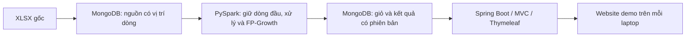

# Thiết kế kỹ thuật đề xuất

Ngày **13/10/2026**. Căn cứ: [RTM](01_REQUIREMENT_MATRIX.md), [U-01–U-18](07_CONFIRMED_SCOPE.md), [đặc tả](11_SPECIFICATION_DRAFT.md), [khảo sát](10_DATASET_PROFILE.md).

**Đọc nhanh:** U-20 chốt batch riêng, MongoDB giữ nguồn/lineage, dữ liệu phân tích chỉ dòng đầu, web đọc kết quả hoàn chỉnh cùng lượt. U-21 loại TEST; U-22 yêu cầu full run cả hai; U-23 đổi vai trò. Chi tiết field/type/config/index cần kiểm chứng ở M1, chưa phải DB/code đã tạo.

## 1. Thành phần và trách nhiệm

| Thành phần | Trách nhiệm đề xuất | Truy vết |
| --- | --- | --- |
| Bộ nhập XLSX | Kiểm tra hash/header/sheet; ghi dữ liệu nguồn và vị trí dòng vào MongoDB để Spark đọc. Không làm mất giá trị nguyên bản. | B-D04–B-D06; B-T01; U-10 |
| PySpark batch | Chuẩn hóa, khử trùng theo U-16, lọc giao dịch và phân loại item; gom giỏ; thống kê, FP-Growth, so sánh theo U-18; ghi kết quả. | B-D09–B-D15; B-T02/B-T06; B-H03–B-H06 |
| MongoDB | Lưu đầu vào, giỏ và các đầu ra có phiên bản. Dữ liệu nguồn phục vụ đối chiếu, không đưa dòng lặp vào phép phân tích sau khử trùng. | B-H02; B-T01/B-T04 |
| Spring Boot/MVC/Thymeleaf | Đọc kết quả, hiển thị phân tích/luật; kiểm tra giỏ, áp dụng/xếp hạng luật đã khai phá. | B-F01/B-F02/B-H09; U-11/U-12 |
| Hồ sơ lượt chạy | Nguồn, chính sách, tham số, môi trường, số bản ghi theo bước và đánh giá; hướng dẫn tái tạo cho từng laptop. | B-E01–B-E07; B-O05/B-O06; U-15 |

Giữ file XLSX gốc. Nếu MongoDB lưu dòng nguồn để kiểm toán, dòng lặp đó thuộc **nguồn**, không phải dữ liệu sạch hoặc giỏ; P-01 chỉ cho phép một lần xuất hiện trong dữ liệu phân tích.

## 2. Quy ước dữ liệu Python–MongoDB–Java

| Nhóm dữ liệu | Quy ước đề xuất |
| --- | --- |
| Dataset | Dataset ID dựa trên SHA-256 file nguồn; kiểm tra sheet/header trước nhập. |
| Vị trí nguồn | `sheet_index` theo thứ tự workbook, `source_row` theo dòng Excel (header không thuộc dữ liệu). Không lấy thứ tự trả về của MongoDB/Spark làm “lần đầu”. |
| Invoice/StockCode/Customer ID | ID nghiệp vụ dạng chuỗi sau chuẩn hóa; giữ giá trị gốc để dedup đúng. Null khác chuỗi rỗng ở bước so khớp nguồn; không bù Customer ID giả. |
| Bộ giá trị khử trùng | Tám giá trị nguồn đã đọc, trước trim/đổi chữ hoa/làm tròn. Giá trị số bằng nhau (1 và 1.0) so theo giá trị; chuỗi/ngày/null giữ ý nghĩa đã đọc. Không kèm sheet/dòng vào khóa so trùng. |
| Tiền | Giữ decimal text từ giá trị nguồn; Spark tính với kiểu decimal được chọn sau kiểm tra scale. Đề xuất lưu tổng tiền bằng chuỗi decimal, Java đọc bằng BigDecimal; không sort/range tiền bằng thứ tự chuỗi trong DB. Chỉ định dạng/làm tròn ở hiển thị. Đây là lựa chọn cần kiểm chứng, chưa là cấu hình mapper đã chạy. |
| Thời gian hóa đơn | ISO local datetime theo nguồn, không tự gán UTC vì timezone chưa xác minh. Mốc chia dùng cùng cách hiểu; thời gian hệ thống ghi log là UTC và tách biệt. |
| Item/tiền đề | Array chuỗi duy nhất, sắp mã theo quy tắc cố định khi tạo khóa/tie-break. Kết luận luật FP-Growth là một item, lưu dạng chuỗi. |
| Chỉ số luật | support/confidence/lift số thực, kiểm tra hữu hạn và miền hợp lệ; không diễn giải confidence thành xác suất cá nhân. |
| Lượt chạy | `run_id` mới cho mỗi cấu hình/lần thử, gắn dataset/basket set/chính sách/phần dữ liệu. Dữ liệu đã công bố giữ bất biến; sửa cấu hình tạo lượt mới. |

Canonical serialization cho tám giá trị phải có ranh giới/kiểu rõ; không nối chuỗi bằng dấu phân cách có thể xuất hiện trong Description. Nếu dùng hash hỗ trợ tìm trùng, vẫn xác minh tuple tương đương, không dựa riêng hash để xóa dòng.

Spring Data có mapping BigDecimal với string hoặc Decimal128; phải chỉ rõ lựa chọn, không dựa vào giả định mặc định. [Spring Data mapping](https://docs.spring.io/spring-data/mongodb/reference/mongodb/mapping/mapping.html).

## 3. Collection và khóa đề xuất

Các tên/field dưới đây là thiết kế dự án, không phải tên API của thư viện. Chưa tạo database hoặc index. Có thể gộp/rút gọn khi thử thực tế chứng minh cần; không lưu toàn bộ dataset hay luật trong một document.

| Collection | Một document đại diện cho | Khóa/nội dung tối thiểu |
| --- | --- | --- |
| `datasets` | Một nguồn nhập | `_id=dataset_id`; URL/hash/sheet, schema_version, trạng thái nhập, số dòng kỳ vọng/thực tế. |
| `source_rows` | Một dòng nguồn | `_id` từ dataset + sheet_index + source_row; tám giá trị gốc, giá trị chuẩn hóa cần đọc và vị trí nguồn. Khóa unique vị trí, không unique Invoice. |
| `baskets` | Một hóa đơn sau xử lý | `basket_set_id` + Invoice unique; items duy nhất, invoice_time đại diện, số dòng và thông tin chất lượng. Basket set gắn dataset + cleaning_policy_version để dùng lại giữa các cấu hình. |
| `runs` | Một cấu hình và lượt khai phá/đánh giá | `_id=run_id`; basket_set_id, policy/ranking/schema/code_version, mốc chia/seed/K/tham số/env, trạng thái và manifest số lượng; metric phát triển/cuối tách rõ. |
| `items` | Một item trong danh mục của lượt khai phá | `run_id` + StockCode unique; tên từ phần lịch sử được phép, số giỏ chứa item để xếp baseline. |
| `frequent_itemsets` | Một tập phổ biến | `run_id` + khóa tập unique; items, frequency và số giỏ lịch sử làm mẫu số. |
| `association_rules` | Một luật | `run_id` + khóa tiền đề/kết luận unique; antecedent, consequent, confidence/lift/support. |
| `summaries` | Một bảng/thống kê tổng hợp | `basket_set_id` + loại thống kê + bucket unique; số dòng/giỏ, tháng, item, giá trị dòng mua; nêu scope và chính sách. |
| `publication` | Con trỏ lượt kết quả đang phục vụ | Một document active với `run_id`, basket_set_id, version và thời gian công bố; không chứa cả danh sách luật. |

Đề xuất index theo truy vấn: source_rows theo dataset; baskets theo basket_set và Invoice; items theo run và mã; luật theo run/antecedent; summaries theo basket_set/loại/bucket. Khóa unique dùng giá trị scalar hoặc khóa tuple chuẩn hóa, không dùng unique multikey thay cho kiểm tra set.

Index `run_id + antecedent` chỉ có một field array. Không đề xuất index compound trên cả antecedent và một array consequent; MongoDB hạn chế mỗi document có tối đa một indexed array field trong compound multikey index. [Multikey indexes](https://www.mongodb.com/docs/manual/core/indexes/index-types/index-multikey/), [Unique indexes](https://www.mongodb.com/docs/manual/core/index-unique/).

## 4. Luồng batch và giữ đúng lần xuất hiện đầu

1. Kiểm tra nguồn/header/thứ tự sheet, nhập có vị trí và hoàn tất đối chiếu số dòng. Dataset chưa READY thì job không đọc như nguồn đầy đủ.
2. Spark đọc schema tường minh; nhóm theo tuple tám giá trị nguồn, sắp `sheet_index, source_row`, giữ rank đầu. Dùng window và row_number là hướng triển khai; không dựa một phép dropDuplicates để quyết định vị trí đầu.
3. Với nguồn hiện tại, bước P-01 phải đối chiếu **1.067.371 = 34.335 + 1.033.036** trước các bộ lọc khác; đây là mốc kiểm tra nguồn cố định, không phải ngưỡng rubric.
4. Phân nhánh thống kê chất lượng và giao dịch mua; loại hủy/điều chỉnh/giá không hợp lệ khỏi giỏ theo đặc tả. Mapping P-02 có phiên bản; không mất số lượng/giá trong bảng dòng hàng.
5. Tạo giỏ item duy nhất theo Invoice; thời điểm đại diện dự kiến nhỏ nhất trong hóa đơn. Không prefix sheet. Ghi/reuse basket set hoàn chỉnh.
6. Chia hóa đơn theo thời gian; fit luật và tính baseline chỉ trên lịch sử. Chọn cấu hình từ phần phát triển; phần đánh giá cuối không dùng chọn cấu hình.
7. Ghi itemsets/rules/catalog/metrics vào run mới, đối chiếu số lượng và thông số trước công bố. Website demo đề xuất dùng chính mô hình lịch sử đã đánh giá; refit toàn bộ dữ liệu là lựa chọn riêng, chưa mặc định thêm.

[PySpark row_number](https://spark.apache.org/docs/4.2.0/api/python/reference/pyspark.sql/api/pyspark.sql.functions.row_number.html) hỗ trợ rank theo window; toàn bộ luồng trên chưa chạy trong Spark. K, seed, mốc chia và tham số giữ trạng thái chưa chốt.

Thống kê toàn bộ dữ liệu sạch khác mẫu số khai phá chỉ từ lịch sử. UI phải ghi scope để không lấy support từ mẫu số dashboard. U-21 đã chọn loại TEST001/TEST002 khỏi khai phá/gợi ý; phải tính lại counts theo policy mới, audit cũ chỉ là đối chiếu lịch sử.

## 5. Chạy lại và công bố kết quả

Đề xuất một writer batch local tại một thời điểm. ID đầu vào xác định theo vị trí giúp chạy lại không nhân bản source_rows; ID kết quả xác định theo run/khóa nghiệp vụ. Retry của run đang ghi chỉ được ghi cùng cấu hình/dữ liệu; không sửa run đã công bố. Không dùng overwrite/drop/reset toàn DB để giải quyết lỗi.

Trạng thái dự kiến: WRITING → VALIDATED → READY, lỗi thành FAILED. Công bố sau khi:
- Đủ collection/manifest kỳ vọng, checksum/count/quan hệ catalog–rule đúng.
- Chỉ số/tham số và các phần train/dev/test được kiểm tra.
- Writer đã kết thúc và dữ liệu đầu ra của run được giữ bất biến.

Sau đó thay **một document con trỏ active** bằng cập nhật có điều kiện dựa version/con trỏ trước. Nếu không khớp, dừng công bố và kiểm tra; không ghi đè mù. MongoDB atomic ở một document; ghi nhiều document không tự nguyên tử. Đây là thiết kế công bố trên dữ liệu bất biến, không giả lập transaction đa document. [MongoDB atomicity](https://www.mongodb.com/docs/manual/core/write-operations-atomicity/).

Mỗi request web đọc con trỏ một lần, dùng cùng run/basket_set cho mọi truy vấn. Trang form chọn giỏ mang run/version; khi submit nếu đã đổi lượt thì báo cần tải lại, không trộn catalog cũ với luật mới. Run cũ còn nguyên để request đang phục vụ hoàn tất. Job lỗi không thay con trỏ đang dùng.

Connector có tùy chọn operationType/idFieldList/upsertDocument; chỉ chọn cấu hình sau thử đúng bản để xác minh idempotency, không chép default rồi coi retry an toàn. [Batch write configuration](https://www.mongodb.com/docs/spark-connector/current/batch-mode/batch-write-config/).

## 6. Website và suy ra gợi ý

Đề xuất cùng một ứng dụng MVC, ba khu vực theo file 11; Spring Data chỉ đọc kết quả. Chưa chốt URL/controller/DTO contract, tránh coi bản này là public API đã duyệt.

- Tổng quan: đọc summaries và manifest, có tháng/phân trang và nêu scope.
- Luật: đọc đúng run, lọc/hiển thị antecedent/consequent và các chỉ số; giới hạn/phân trang sau đo.
- Giỏ: nhận mã item, kiểm tra danh mục của run, loại chọn trùng; không nhận object truy vấn MongoDB từ browser.
- Truy vấn luật có item tiền đề liên quan, rồi kiểm tra **toàn bộ** tiền đề nằm trong giỏ; không dùng điều kiện “có ít nhất một item chung” làm luật hợp lệ. Chưa cắt Top-K luật trước khi lọc toàn tiền đề, vì có thể bỏ gợi ý hợp lệ.
- Loại kết luận đã có, hợp nhất theo item; chọn luật tốt nhất confidence/lift/support, tie dùng mã item và tiền đề chuẩn hóa. Áp dụng cùng comparator/điều kiện trong offline và Java.
- Không có luật: hiển thị chưa có gợi ý, không âm thầm fallback phổ biến. Baseline dùng cho đánh giá, không đồng nghĩa bật fallback.
- Kiểm tra input, escape tên/mô tả khi render, dùng truy vấn có cấu trúc; không thêm auth/payment hoặc chạy Python/Spark trong request.

Nếu số luật khiến query/xếp hạng nặng, đo trước khi thay thiết kế; không tự cap luật/giỏ hoặc chuyển thành microservice.

## 7. Demo trên cả hai máy và kiểm chứng cần thực hiện

U-22 yêu cầu cả hai máy **tự full run** từ toàn nguồn, cùng hash/policy/schema/cấu hình cuối. Mỗi máy cần receipt nhập nguồn, Spark xử lý/fit train/đánh giá và web thật. Import output không thay nghiệm thu. Sau batch có thể dừng Spark để demo web; không bắt cả hai chạy lại mọi cấu hình thử trên development.

Theo U-24 cả hai Windows 11/RAM 16 GB/50 GB trống; CPU/kiến trúc và bản phần mềm cần kiểm tra, chưa khẳng định đủ tài nguyên. TV1/người dùng data/Spark, TV2 Java/web theo U-23.

| Kiểm chứng sau thiết kế | Thành phẩm cần có |
| --- | --- |
| Bộ phiên bản và kết nối Windows | Receipt riêng hai máy; Python/Spark/Scala/connector/JDK/MongoDB/Boot và lỗi nếu có. |
| P-01 trong Spark | Count đối chiếu audit, chọn đúng source row đầu dù partition/DB trả thứ tự khác; khác giá/số lượng không bị gộp. |
| Mapping Python–BSON–Java | ID, null/array, decimal text và thời gian local đọc lại không đổi ý nghĩa. |
| Công bố/retry | Thử lỗi ghi dở trên dữ liệu thử riêng; run hiện hành không đổi, retry không nhân bản, form stale được xử lý. |
| Luật và ranking | Ví dụ tính tay; luật nhiều tiền đề, item đã có, tie và không có luật; kết quả Python/Java nhất quán. |
| Dataset đầy đủ/tài nguyên | Thời gian/RAM/đĩa theo bước, riêng từng máy đã chạy; không suy đủ 16 GB từ audit đọc XLSX. |

Đây là thử nghiệm đề xuất, chưa chạy hoặc cài đặt trong lần thiết kế. Không cam kết full run trong buổi demo, lịch làm việc hoặc tốc độ.

## 8. Trạng thái bàn giao

**Đã chốt:** stack, P-01/P-02/P-03 và hướng kiến trúc/test/full run/roles theo U-20–U-26. **Đã kiểm tra:** nguồn/audit policy cũ ở file 10. **Còn kiểm chứng:** field/type/config/versions, policy có loại TEST và full run từng máy. Dataset và khung B/quy cách A được GV chấp thuận theo người dùng; chưa có runtime.

B-P17 được người dùng xác nhận giải quyết theo U-25; U-26 chốt khung B + quy cách A, không hỏi lại. Chưa cài môi trường, tạo DB/schema/index, triển khai app hoặc chạy FP-Growth. Thiết kế không thay đổi 282 dòng yêu cầu nguồn hoặc trọng số.

**Kế hoạch tiếp theo:** [Master Plan](13_MASTER_IMPLEMENTATION_PLAN.md) đưa thiết kế này vào mốc M0 để review; U-20 đã chốt hướng; chi tiết field/type/config và công bố phải kiểm chứng, không coi việc có tài liệu là runtime hoặc tự cài đặt.
