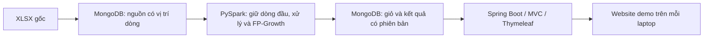

# Thiết kế kỹ thuật đề xuất

Ngày cập nhật **14/10/2026**. Căn cứ: [RTM](01_REQUIREMENT_MATRIX.md), [U-01–U-30](07_CONFIRMED_SCOPE.md), [đặc tả](11_SPECIFICATION_DRAFT.md), [khảo sát](10_DATASET_PROFILE.md).

**Review M0 đã hoàn tất về tài liệu:** hợp đồng được Agent bổ sung/đối chiếu; người dùng xác nhận cả TV1/TV2 đã review, chấp thuận bản hiện tại theo U-30. Mục 9–13 cụ thể hóa các mục 1–8. **M0-D1/D2/D3 đã chọn — U-27/U-28/U-29**: run bất biến + con trỏ, decimal text, dashboard hàng hóa + audit. Không thêm Requirement ID. M0 đóng ngày 14/10/2026; không có schema/index/code/runtime được tạo.

**Đọc nhanh:** U-20 chốt batch riêng, MongoDB giữ nguồn/lineage, dữ liệu phân tích chỉ dòng đầu, web đọc kết quả hoàn chỉnh cùng lượt. U-21 loại TEST; U-22 yêu cầu full run cả hai; U-23 đổi vai trò. Chi tiết field/type/config/index cần kiểm chứng ở M1, chưa phải DB/code đã tạo.

## 1. Thành phần và trách nhiệm

| Thành phần | Trách nhiệm đề xuất | Truy vết |
| --- | --- | --- |
| Bộ nhập XLSX | Kiểm tra hash/header/sheet; ghi dữ liệu nguồn và vị trí dòng vào MongoDB để Spark đọc. Không làm mất giá trị nguyên bản. | B-D04–B-D06; B-T01; U-10 |
| PySpark batch | Chuẩn hóa, khử trùng theo U-16, lọc giao dịch và phân loại item; gom giỏ; thống kê, FP-Growth, so sánh theo U-18; ghi kết quả. | B-D09–B-D15; B-T02/B-T06; B-H03–B-H06 |
| MongoDB | Lưu đầu vào, giỏ và các đầu ra có phiên bản. Dữ liệu nguồn phục vụ đối chiếu, không đưa dòng lặp vào phép phân tích sau khử trùng. | B-H02; B-T01/B-T04 |
| Spring Boot/MVC/Thymeleaf | Đọc kết quả, hiển thị phân tích/luật; kiểm tra giỏ, áp dụng/xếp hạng luật đã khai phá. | B-F01/B-F02/B-H09; U-11/U-12 |
| Hồ sơ lượt chạy | Nguồn, chính sách, tham số, môi trường, số bản ghi theo bước và đánh giá; hướng dẫn tái tạo cho từng laptop. | B-E01–B-E07; B-O05/B-O06; U-15 |

Giữ file XLSX gốc. Nếu MongoDB lưu dòng nguồn để kiểm toán, dòng lặp đó thuộc **nguồn**, không phải dữ liệu sạch hoặc giỏ; P-01 chỉ cho phép một lần xuất hiện trong dữ liệu phân tích.

## 2. Quy ước dữ liệu Python–MongoDB–Java

| Nhóm dữ liệu | Quy ước đề xuất |
| --- | --- |
| Dataset | Dataset ID dựa trên SHA-256 file nguồn; kiểm tra sheet/header trước nhập. |
| Vị trí nguồn | `sheet_index` theo thứ tự workbook, `source_row` theo dòng Excel (header không thuộc dữ liệu). Không lấy thứ tự trả về của MongoDB/Spark làm “lần đầu”. |
| Invoice/StockCode/Customer ID | ID nghiệp vụ dạng chuỗi sau chuẩn hóa; giữ giá trị gốc để dedup đúng. Null khác chuỗi rỗng ở bước so khớp nguồn; không bù Customer ID giả. |
| Bộ giá trị khử trùng | Tám giá trị nguồn đã đọc, trước trim/đổi chữ hoa/làm tròn. Giá trị số bằng nhau (1 và 1.0) so theo giá trị; chuỗi/ngày/null giữ ý nghĩa đã đọc. Không kèm sheet/dòng vào khóa so trùng. |
| Tiền | Giữ decimal text từ giá trị nguồn; Spark tính với kiểu decimal được chọn sau kiểm tra scale. U-28 chọn lưu tiền bằng chuỗi decimal, Java đọc bằng BigDecimal; không sort/range tiền bằng thứ tự chuỗi trong DB. Chỉ định dạng/làm tròn ở hiển thị. Kiểu lưu đã chọn, mapper/round-trip chưa chạy. |
| Thời gian hóa đơn | ISO local datetime theo nguồn, không tự gán UTC vì timezone chưa xác minh. Mốc chia dùng cùng cách hiểu; thời gian hệ thống ghi log là UTC và tách biệt. |
| Item/tiền đề | Array chuỗi duy nhất, sắp mã theo quy tắc cố định khi tạo khóa/tie-break. Kết luận luật FP-Growth là một item, lưu dạng chuỗi. |
| Chỉ số luật | support/confidence/lift số thực, kiểm tra hữu hạn và miền hợp lệ; không diễn giải confidence thành xác suất cá nhân. |
| Lượt chạy | `run_id` mới cho mỗi cấu hình/lần thử, gắn dataset/basket set/chính sách/phần dữ liệu. Dữ liệu đã công bố giữ bất biến; sửa cấu hình tạo lượt mới. |

Canonical serialization cho tám giá trị phải có ranh giới/kiểu rõ; không nối chuỗi bằng dấu phân cách có thể xuất hiện trong Description. Nếu dùng hash hỗ trợ tìm trùng, vẫn xác minh tuple tương đương, không dựa riêng hash để xóa dòng.

Spring Data có mapping BigDecimal với string hoặc Decimal128; phải chỉ rõ lựa chọn, không dựa vào giả định mặc định. [Spring Data mapping](https://docs.spring.io/spring-data/mongodb/reference/mongodb/mapping/mapping.html).

## 3. Collection và khóa đề xuất

Các tên/field dưới đây là thiết kế dự án, không phải tên API của thư viện. Chưa tạo database hoặc index. Bộ collection chọn theo M0-D1/U-27, contract được review theo U-30; không tự gộp/đổi khóa nếu ảnh hưởng hợp đồng giữa hai thành viên. Không lưu toàn bộ dataset hay luật trong một document.

| Collection | Một document đại diện cho | Khóa/nội dung tối thiểu |
| --- | --- | --- |
| `datasets` | Một nguồn nhập | `_id=dataset_id`; URL/hash/sheet, schema_version, trạng thái nhập, số dòng kỳ vọng/thực tế. |
| `source_rows` | Một dòng nguồn | `_id` từ dataset + sheet_index + source_row; tám giá trị gốc, giá trị chuẩn hóa cần đọc và vị trí nguồn. Khóa unique vị trí, không unique Invoice. |
| `baskets` | Một hóa đơn sau xử lý | `basket_set_id` + Invoice unique; items duy nhất, invoice_time đại diện, số dòng và thông tin chất lượng. Basket set gắn dataset + cleaning_policy_version để dùng lại giữa các cấu hình. |
| `runs` | Một cấu hình và lượt khai phá/đánh giá | `_id=run_id`; basket_set_id, policy/ranking/schema/code_version, mốc chia/seed/K/tham số/env, trạng thái và manifest số lượng; metric phát triển/cuối tách rõ. |
| `items` | Một item trong danh mục của lượt khai phá | `run_id` + StockCode unique; tên từ phần lịch sử được phép, số giỏ chứa item để xếp baseline. |
| `frequent_itemsets` | Một tập phổ biến | `run_id` + khóa tập unique; items, frequency và số giỏ lịch sử làm mẫu số. |
| `association_rules` | Một luật | `run_id` + khóa tiền đề/kết luận unique; antecedent, consequent, confidence/lift/support. |
| `summaries` | Một bảng/thống kê tổng hợp | `basket_set_id` + scope + loại thống kê + bucket unique; số dòng/giỏ, tháng, item, giá trị dòng mua; nêu mẫu số và chính sách. |
| `publication` | Con trỏ lượt kết quả đang phục vụ | Một document active với `run_id`, basket_set_id, version và thời gian công bố; không chứa cả danh sách luật. |

Đề xuất index theo truy vấn: source_rows theo dataset; baskets theo basket_set và Invoice; items theo run và mã; luật theo run/antecedent; summaries theo basket_set/loại/bucket. Khóa unique dùng giá trị scalar hoặc khóa tuple chuẩn hóa, không dùng unique multikey thay cho kiểm tra set.

Index `run_id + antecedent` chỉ có một field array. Không đề xuất index compound trên cả antecedent và một array consequent; MongoDB hạn chế mỗi document có tối đa một indexed array field trong compound multikey index. [Multikey indexes](https://www.mongodb.com/docs/manual/core/indexes/index-types/index-multikey/), [Unique indexes](https://www.mongodb.com/docs/manual/core/index-unique/).

## 4. Luồng batch và giữ đúng lần xuất hiện đầu

1. Kiểm tra nguồn/header/thứ tự sheet, nhập có vị trí và hoàn tất đối chiếu số dòng. Dataset chưa READY thì job không đọc như nguồn đầy đủ.
2. Spark đọc schema tường minh; nhóm theo tuple tám giá trị nguồn, sắp `sheet_index, source_row`, giữ rank đầu. Dùng window và row_number là hướng triển khai; không dựa một phép dropDuplicates để quyết định vị trí đầu.
3. Với nguồn hiện tại, bước P-01 phải đối chiếu **1.067.371 = 34.335 + 1.033.036** trước các bộ lọc khác; đây là mốc kiểm tra nguồn cố định, không phải ngưỡng rubric.
4. Phân nhánh thống kê chất lượng và giao dịch mua; loại hủy/điều chỉnh/giá không hợp lệ khỏi giỏ theo đặc tả. Mapping P-02 có phiên bản; không mất số lượng/giá trong bảng dòng hàng.
5. Tạo giỏ item duy nhất theo Invoice; thời điểm đại diện dự kiến nhỏ nhất trong hóa đơn. Không prefix sheet. Ghi/reuse basket set hoàn chỉnh.
6. Chia hóa đơn theo thời gian; fit luật và tính baseline chỉ trên lịch sử. Chọn cấu hình từ phần phát triển; phần đánh giá cuối không dùng chọn cấu hình.
7. Ghi itemsets/rules/catalog/metrics vào run mới, đối chiếu số lượng và thông số trước công bố. Website demo đề xuất dùng chính mô hình lịch sử đã đánh giá; refit toàn bộ dữ liệu là lựa chọn riêng, chưa mặc định thêm.

[PySpark row_number](https://spark.apache.org/docs/4.2.0/api/python/reference/pyspark.sql/api/pyspark.sql.functions.row_number.html) hỗ trợ rank theo window; toàn bộ luồng trên chưa chạy trong Spark. K, seed, mốc chia và tham số giữ trạng thái chưa chốt.

Thống kê toàn bộ dữ liệu sạch khác mẫu số khai phá chỉ từ lịch sử. UI phải ghi scope để không lấy support từ mẫu số dashboard. U-21 đã chọn loại TEST001/TEST002 khỏi khai phá/gợi ý; phải tính lại counts theo policy mới, audit cũ chỉ là đối chiếu lịch sử.

## 5. Chạy lại và công bố kết quả

Đề xuất một writer batch local tại một thời điểm. ID đầu vào xác định theo vị trí giúp chạy lại không nhân bản source_rows; ID kết quả xác định theo run/khóa nghiệp vụ. Retry của run đang ghi chỉ được ghi cùng cấu hình/dữ liệu; không sửa run đã công bố. Không dùng overwrite/drop/reset toàn DB để giải quyết lỗi.

Trạng thái dự kiến: WRITING → VALIDATED → READY, lỗi thành FAILED. Công bố sau khi:
- Đủ collection/manifest kỳ vọng, checksum/count/quan hệ catalog–rule đúng.
- Chỉ số/tham số và các phần train/dev/test được kiểm tra.
- Writer đã kết thúc và dữ liệu đầu ra của run được giữ bất biến.

Sau đó thay **một document con trỏ active** bằng cập nhật có điều kiện dựa version/con trỏ trước. Nếu không khớp, dừng công bố và kiểm tra; không ghi đè mù. MongoDB atomic ở một document; ghi nhiều document không tự nguyên tử. Đây là thiết kế công bố trên dữ liệu bất biến, không giả lập transaction đa document. [MongoDB atomicity](https://www.mongodb.com/docs/manual/core/write-operations-atomicity/).

Mỗi request web đọc con trỏ một lần, dùng cùng run/basket_set cho mọi truy vấn. Trang form chọn giỏ mang run/version; khi submit nếu đã đổi lượt thì báo cần tải lại, không trộn catalog cũ với luật mới. Run cũ còn nguyên để request đang phục vụ hoàn tất. Job lỗi không thay con trỏ đang dùng.

Connector có tùy chọn operationType/idFieldList/upsertDocument; chỉ chọn cấu hình sau thử đúng bản để xác minh idempotency, không chép default rồi coi retry an toàn. [Batch write configuration](https://www.mongodb.com/docs/spark-connector/current/batch-mode/batch-write-config/).

## 6. Website và suy ra gợi ý

Đề xuất cùng một ứng dụng MVC, ba khu vực theo file 11; Spring Data chỉ đọc kết quả. Chưa chốt URL/controller/DTO contract, tránh coi bản này là public API đã duyệt.

- Tổng quan: đọc summaries và manifest, có tháng/phân trang và nêu scope.
- Luật: đọc đúng run, lọc/hiển thị antecedent/consequent và các chỉ số; giới hạn/phân trang sau đo.
- Giỏ: nhận mã item, kiểm tra danh mục của run, loại chọn trùng; không nhận object truy vấn MongoDB từ browser.
- Truy vấn luật có item tiền đề liên quan, rồi kiểm tra **toàn bộ** tiền đề nằm trong giỏ; không dùng điều kiện “có ít nhất một item chung” làm luật hợp lệ. Chưa cắt Top-K luật trước khi lọc toàn tiền đề, vì có thể bỏ gợi ý hợp lệ.
- Loại kết luận đã có, hợp nhất theo item; chọn luật tốt nhất confidence/lift/support, tie dùng mã item và tiền đề chuẩn hóa. Áp dụng cùng comparator/điều kiện trong offline và Java.
- Không có luật: hiển thị chưa có gợi ý, không âm thầm fallback phổ biến. Baseline dùng cho đánh giá, không đồng nghĩa bật fallback.
- Kiểm tra input, escape tên/mô tả khi render, dùng truy vấn có cấu trúc; không thêm auth/payment hoặc chạy Python/Spark trong request.

Nếu số luật khiến query/xếp hạng nặng, đo trước khi thay thiết kế; không tự cap luật/giỏ hoặc chuyển thành microservice.

## 7. Demo trên cả hai máy và kiểm chứng cần thực hiện

U-22 yêu cầu cả hai máy **tự full run** từ toàn nguồn, cùng hash/policy/schema/cấu hình cuối. Mỗi máy cần receipt nhập nguồn, Spark xử lý/fit train/đánh giá và web thật. Import output không thay nghiệm thu. Sau batch có thể dừng Spark để demo web; không bắt cả hai chạy lại mọi cấu hình thử trên development.

Theo U-24 cả hai Windows 11/RAM 16 GB/50 GB trống; CPU/kiến trúc và bản phần mềm cần kiểm tra, chưa khẳng định đủ tài nguyên. TV1/người dùng data/Spark, TV2 Java/web theo U-23.

| Kiểm chứng sau thiết kế | Thành phẩm cần có |
| --- | --- |
| Bộ phiên bản và kết nối Windows | Receipt riêng hai máy; Python/Spark/Scala/connector/JDK/MongoDB/Boot và lỗi nếu có. |
| P-01 trong Spark | Count đối chiếu audit, chọn đúng source row đầu dù partition/DB trả thứ tự khác; khác giá/số lượng không bị gộp. |
| Mapping Python–BSON–Java | ID, null/array, decimal text và thời gian local đọc lại không đổi ý nghĩa. |
| Công bố/retry | Thử lỗi ghi dở trên dữ liệu thử riêng; run hiện hành không đổi, retry không nhân bản, form stale được xử lý. |
| Luật và ranking | Ví dụ tính tay; luật nhiều tiền đề, item đã có, tie và không có luật; kết quả Python/Java nhất quán. |
| Dataset đầy đủ/tài nguyên | Thời gian/RAM/đĩa theo bước, riêng từng máy đã chạy; không suy đủ 16 GB từ audit đọc XLSX. |

Đây là thử nghiệm đề xuất, chưa chạy hoặc cài đặt trong lần thiết kế. Không cam kết full run trong buổi demo, lịch làm việc hoặc tốc độ.

## 8. Trạng thái bàn giao

**Đã chốt:** stack, P-01/P-02/P-03 và hướng kiến trúc/test/full run/roles theo U-20–U-26. **Đã kiểm tra:** nguồn/audit policy cũ ở file 10. **Còn kiểm chứng:** field/type/config/versions, policy có loại TEST và full run từng máy. Dataset và khung B/quy cách A được GV chấp thuận theo người dùng; chưa có runtime.

B-P17 được người dùng xác nhận giải quyết theo U-25; U-26 chốt khung B + quy cách A, không hỏi lại. Chưa cài môi trường, tạo DB/schema/index, triển khai app hoặc chạy FP-Growth. Thiết kế không thay đổi 282 dòng yêu cầu nguồn hoặc trọng số.

**Kế hoạch tiếp theo:** [Master Plan](13_MASTER_IMPLEMENTATION_PLAN.md) đưa thiết kế này vào mốc M0 để review; U-20 đã chốt hướng; chi tiết field/type/config và công bố phải kiểm chứng, không coi việc có tài liệu là runtime hoặc tự cài đặt.

## 9. Lựa chọn đã trả lời và contract đã được chấp thuận

| Mã | Phương án đề nghị | Phương án khác và trade-off | Trạng thái |
| --- | --- | --- | --- |
| M0-D1 — collection và công bố | Giữ chín collection ở mục 3; kết quả theo run bất biến, một writer batch trên mỗi máy, một con trỏ `publication`. Web tiếp tục đọc run cũ khi batch chạy/lỗi; một request và form dùng cùng run/version. | Dừng web khi chuyển lượt, chỉ khởi động sau khi kiểm tra toàn bộ đầu ra: ít logic đổi lượt trực tuyến hơn nhưng demo phải gián đoạn. Phương án này không chọn. Ghi đè khi web đang đọc không đáp ứng tính toàn vẹn. | **Đã chọn run bất biến + con trỏ — U-27.** Chi tiết mục 10–12 được TV1/TV2 chấp thuận theo U-30; không cần thêm server/replica set. |
| M0-D2 — kiểu tiền tại MongoDB | Decimal text ở biên MongoDB; Spark tính decimal tường minh, Java đọc BigDecimal. Batch đã tính tổng/thứ hạng cần dùng; web không sort/range tiền bằng chuỗi. | BSON Decimal128 hỗ trợ truy vấn số trực tiếp trong DB nhưng thêm chuyển đổi/kiểm tra giới hạn giữa connector và Java. Có lợi nếu cần DB tính/lọc tiền; phương án này không chọn cho scope hiện tại. | **Đã chọn decimal text — U-28.** Precision/scale Spark và mapper vẫn phải thử ở M1; kiểu lưu được duyệt không chứng minh round-trip PASS. |

MongoDB xác nhận tính nguyên tử ở một document và điều kiện cập nhật phải còn khớp; cơ chế con trỏ trên output bất biến là **thiết kế của dự án suy ra từ tính chất đó**, không phải đảm bảo nguyên tử nhiều collection. [MongoDB atomicity](https://www.mongodb.com/docs/manual/core/write-operations-atomicity/). Spring Data có biểu diễn BigDecimal bằng String/NumberDecimal, vì vậy cần mapping tường minh theo bản thực tế; chưa chọn bản phần mềm ở M0. [Spring Data mapping](https://docs.spring.io/spring-data/mongodb/reference/mongodb/mapping/mapping.html). Đã tra cứu hai tài liệu chính thức ngày 14/10/2026; không thay thử nghiệm M1.

## 10. Hợp đồng input, kiểu dữ liệu và định danh để review

Các quy ước kỹ thuật nhỏ dưới đây cụ thể hóa U-16–U-20/U-27–U-29, không thay chính sách. Sau xác nhận review U-30, bản contract được khóa về tài liệu với **`schema_version=m0-contract-v1`**, ngày 14/10/2026. Đây là version hợp đồng dự án, không phải schema DB đã tạo hoặc mapper đã chạy. Các tham số/version phần mềm/policy runtime còn kiểm chứng theo milestone; đổi ngữ nghĩa contract phải review và tăng version.

### 10.1. Input và nguồn

- Nguồn cố định: XLSX/hash tại file 10; hai sheet theo thứ tự `Year 2009-2010`, `Year 2010-2011`. Header lần lượt `Invoice`, `StockCode`, `Description`, `Quantity`, `InvoiceDate`, `Price`, `Customer ID`, `Country`. Đổi hash/header/sheet phải báo khác nguồn, không âm thầm xử lý theo số kiểm tra cũ.
- `dataset_id`: SHA-256 lowercase của bytes XLSX; `sheet_index` bắt đầu 0; `source_row` là số dòng Excel bắt đầu 2 cho dữ liệu. Sheet name và header được ghi trong metadata. Tổng nhập phải khớp từng sheet rồi mới cho đọc như dataset READY.
- `source_cells`: tám ô theo đúng thứ tự header, mỗi ô giữ nhãn kiểu (`null`, `number`, `text`, `local_datetime`) và payload giá trị đã đọc. Payload text không trim/đổi hoa/thường; null không đổi thành chuỗi rỗng. Số và ngày có dạng tuần tự hóa tường minh. XLSX vẫn là bản gốc cho đối chiếu bytes/ô; archive không được gọi là bản sao byte của XLSX.
- P-01 so tám giá trị **trước chuẩn hóa**: number 1 và 1.0 bằng nhau theo giá trị; number 1 và text `"1"` khác nhau; whitespace/case của text giữ nguyên; ngày và null giữ kiểu riêng. Sheet/dòng không nằm trong khóa so trùng. Chọn vị trí nhỏ nhất `(sheet_index, source_row)` trên cả workbook.
- `source_rows._id`: chuỗi JSON canonical của `[dataset_id, sheet_index, source_row]`, không nối tùy ý bằng dấu phân cách. Nếu cùng vị trí nhưng payload khác, dừng nhập và đối chiếu nguồn; không ghi đè. Dataset đã READY không được chỉnh raw rows khi chạy lại.

Các điều kiện XLSX/hash/count nguồn trên áp dụng cho **FULL_SOURCE Online Retail II**. M1 được dùng fixture/giỏ tự tạo theo Master Plan: metadata ghi `dataset_kind=SYNTHETIC`, `mode=SAMPLE`, hash nội dung fixture riêng và nguồn tự tạo; không giả gắn hash/count Online Retail II hoặc nhãn khoa học final. Source rows mẫu để kiểm tra round-trip/P-01 vẫn theo cùng contract kiểu/vị trí; không thay nghiệm thu toàn nguồn.

### 10.2. Kiểu dùng trong phân tích và tại biên web

| Trường/nhóm | Quy ước | Lỗi và kiểm chứng |
| --- | --- | --- |
| `invoice`, `stock_code`, `customer_id` | Chuỗi nghiệp vụ; ô số nguyên đọc thành chuỗi chữ số không có `.0`; text chỉ bỏ whitespace ngoài, giữ case và số 0 đầu nếu có trong text. Customer ID thiếu giữ null. | Không ép StockCode thành số hoặc uppercase toàn bộ. Nhiều raw spelling quy về cùng ID phải ghi audit để review, không âm thầm gộp mã khác nghĩa. |
| `description`, `country` | Giá trị nguồn còn nguyên trong source_cells; tên hiển thị dùng mô tả text không rỗng từ train, trim ngoài. Ô mô tả kiểu số ghi lỗi kiểu, không tự coi là tên sản phẩm. | Không bỏ giao dịch chỉ vì thiếu mô tả/khách; tên thiếu hiển thị mã. Tên modal theo số dòng hàng train sau policy, tie theo thứ tự mã Unicode; không lấy tên từ dev/test. |
| `quantity`, counts | Quantity phải là số nguyên trong miền lưu được kiểm chứng; counts/frequency dùng số nguyên 64 bit tại biên. Không chuyển counts thành số thực. | Sai kiểu/tràn phải được ghi rõ; không cast làm mất phần thập phân. |
| `price`, `line_value`, tổng GBP | Giữ biểu diễn decimal từ giá trị số nguồn đã đọc, theo cùng quy ước audit `Decimal(str(value))`; không tuyên bố khôi phục độ chính xác trước khi Excel lưu số. U-28 chọn text: decimal thường dùng dấu chấm, không phân cách hàng nghìn/exponent; `line_value = quantity × price` trước định dạng. | Chọn precision/scale cho giá, phép nhân và tổng riêng sau kiểm tra scale/range. Không âm thầm làm tròn/tràn thành null. Không dùng double làm trung gian để cộng tiền. Hiển thị GBP hai chữ số thập phân theo HALF_UP trên kết quả cuối, không làm tròn từng dòng để tính tổng; giá trị lưu/tính giữ nguyên. |
| `invoice_time_local` | ISO local datetime không `Z`/offset; Spark dùng cách parse không dịch múi giờ, Java đọc LocalDateTime tường minh. Thời điểm giỏ là min InvoiceDate của các dòng hàng còn trong giỏ. | Timezone nguồn UNKNOWN; không tự coi UTC/giờ Việt Nam. Biểu diễn/độ phân giải phải thử đọc lại ở M1. |
| `started_at_utc`, `finished_at_utc`, `published_at_utc` | Mốc hệ thống dạng ISO UTC có `Z`, riêng với ngày hóa đơn. | Không dùng mốc hệ thống làm thời gian split giao dịch. |
| `items`, `antecedent` | Mảng StockCode duy nhất, thứ tự tăng theo Unicode code point, không phụ thuộc locale/thứ tự DB. `consequent` là một chuỗi item. | Tiền đề không rỗng; kết luận không thuộc tiền đề; không lưu set bằng chuỗi ghép dấu phẩy. |
| `support`, `confidence`, `lift` | Số thực hữu hạn, support/confidence trong (0,1], lift > 0; lưu đủ giá trị tính, không làm tròn trước ranking. | Count mẫu số/train giữ cùng run để đối chiếu. M1 kiểm tra giá trị/chênh lệch số thực Python–Java; không tự đổi comparator thành xếp hạng gần bằng. |

Spark DecimalType yêu cầu precision/scale cố định, precision tối đa 38 theo tài liệu tra cứu; **chưa pin một `(p,s)` chỉ từ tài liệu**, phải kiểm tra giá trị và phép tổng ở M1/M2. [PySpark DecimalType](https://spark.apache.org/docs/4.2.0/api/python/reference/pyspark.sql/api/pyspark.sql.types.DecimalType.html). Không để mapper ngày giờ tự suy timezone từ máy; Spring Data có chuyển đổi kiểu Java time sang BSON date nên hợp đồng này cần đọc/ghi chuỗi local tường minh. [Spring Data mapping](https://docs.spring.io/spring-data/mongodb/reference/mongodb/mapping/mapping.html).

### 10.3. Khóa đầu ra và liên kết giữa collection

`basket_set_id` xác định bởi dataset hash + phiên bản parser/schema + hash chính sách làm sạch/mapping + lựa chọn scope phân tích. Thay một thành phần tạo basket set mới. `run_id` là UUID v4 chuỗi mới cho mỗi lần thử/cấu hình; cùng config trên hai máy vẫn có run_id/receipt riêng. Phiên bản code ghi commit và hash phần code chưa commit khi có, không tự gọi working tree là code đã commit.

| Collection | Trường bổ sung bắt buộc trong bản contract đề nghị |
| --- | --- |
| `datasets` | `source_sha256`, nguồn URL/citation, `sheets` (index/name/header/count), parser/schema version, trạng thái nhập và validation; READY chỉ khi nhập đủ, payload/khóa hợp lệ. |
| `source_rows` | `dataset_id`, `sheet_index`, `source_row`, `source_cells`; trường phân tích chuẩn hóa nếu lưu phải có version, không thay payload nguồn. |
| `baskets` | `basket_set_id`, `invoice`, `items`, `invoice_time_local`, `retained_line_count`, quality flags. Khóa từ canonical `[basket_set_id,invoice]`; cùng hóa đơn qua sheet không tách giỏ. Metadata/counts/checksums của basket set được ghi ở manifest, không cần thêm collection mới. |
| `runs` | `run_id`, `dataset_id`, `basket_set_id`, `schema_version`, `policy_version/hash`, `ranking_version`, config/split/hide-item/môi trường/code và manifest ở mục 11. Trạng thái không thay review nghiệm thu. |
| `items` | `run_id`, `stock_code`, `display_name`, `train_basket_count`; khóa `[run_id,stock_code]`. Item train không có luật vẫn có trong danh mục để nhận giỏ và so baseline công bằng. |
| `frequent_itemsets` | `run_id`, `items`, `itemset_key`, `frequency`, `train_basket_count`, `support`. Khóa canonical của items được giữ để kiểm chứng. |
| `association_rules` | `run_id`, `antecedent`, `consequent`, `rule_key`, `support`, `confidence`, `lift`; đối chiếu số giỏ chứa tiền đề, kết luận và hợp của chúng từ train. |
| `summaries` | `basket_set_id`, `scope`, `summary_type`, `bucket_key`, payload counts/GBP, định nghĩa và mẫu số. Scope/danh sách KPI theo M0-D3 ở file 11; không dùng khóa thiếu scope làm ghi đè hai loại thống kê. |
| `publication` | `_id="active"`, `run_id`, `basket_set_id`, `schema_version`, `version` số nguyên tăng mỗi lần đổi pointer, `published_at_utc`. Run phải tham chiếu đúng basket set/schema của pointer. |

Khóa tuple ngắn tuần tự hóa JSON canonical. Khóa tập/luật có thể dùng SHA-256 của canonical array/tuple để `_id` gọn, nhưng phải giữ `itemset_key`/`rule_key` đầy đủ và kiểm tra tương đương khi trùng hash; không dùng hash đơn độc để mất dữ liệu. Khi upsert cùng khóa mà nội dung/config khác, dừng và báo xung đột. Unique index vật lý, config connector và cách canonical encoding cụ thể được thử M1; không tự áp dụng drop/overwrite khi lỗi.

## 11. Manifest và điều kiện đầu ra hoàn chỉnh

Manifest đặt trong `runs`, metadata dataset/basket set tham chiếu được; không đưa dữ liệu chi tiết toàn nguồn/luật vào một document. Các tên trường là hợp đồng dự án, không là API có sẵn.

| Nhóm | Nội dung cần ghi |
| --- | --- |
| Provenance | Hash XLSX, sheet/header/count, dataset_id/basket_set_id, parser/schema/policy/mapping/ranking version và hash, code revision/hash. |
| Runtime | Vai trò máy TV1 hoặc TV2 (không cần thông tin cá nhân), chế độ `SAMPLE` hoặc `FULL_SOURCE`, bản Python/Spark/Scala/connector/JDK/MongoDB/Boot thực tế, cấu hình liên quan, UTC start/end và thời gian theo bước đo được; không lưu URI/password. |
| Stage counts | Raw → P-01 retained → mua dương/hợp lệ → hàng hóa sau P-02/TEST; số giỏ/item và giỏ một item/từ hai item. Counts loại theo bước tuần tự riêng với counts lỗi chồng nhau. |
| Split/fit | Mốc local thời gian train/dev/test, quy tắc biên `[start,end)`, counts từng phần, invoice overlap = 0; tập train làm mẫu số support/baseline/catalog. Timestamp bằng mốc không tách một hóa đơn. K/seed/tham số không được null cho run đánh giá hoàn chỉnh. |
| Hidden item | Seed và thuật toán/chọn item có phiên bản, canonical thứ tự item; cùng basket/seed cho hai phương pháp, không phụ thuộc partition/RNG iteration. M3 chọn chi tiết có căn cứ, M0 không tự tạo seed/mốc. |
| Metrics | `evaluation_stage` ghi SAMPLE/DEVELOPMENT/FINAL; dev/final tách rõ. Final chưa chạy ghi `NOT_RUN`, không bịa metric 0 hoặc chặn run mẫu/phát triển chỉ vì chưa tới M5. Với phần đã chạy: số truy vấn đủ điều kiện, mục tiêu mới ngoài train, truy vấn có gợi ý/tổng hit; Recall@K/tỷ lệ có gợi ý từng phương pháp, numerator/denominator. N=0 ghi `NOT_APPLICABLE`, không chia 0 hoặc coi 0 là chất lượng đã đo. |
| Output validation | Expected/actual count mỗi nhóm output kể cả 0, khóa unique, schema và tham chiếu run/basket set, checksum logic ổn định theo canonical dữ liệu đã sắp; rule/itemset/catalog consistency. Checksum không tính run_id/mốc hệ thống khi so kết quả logic hai máy; cách tính/version phải ghi. |
| Kết quả/giới hạn | Stage trạng thái, lỗi an toàn và bước có thể thử lại, split/config freeze reference, các số đo còn thiếu và review receipt. Run mẫu không gắn nhãn full-source/final hoặc thay nghiệm thu hai máy. |

Counts đối chiếu: `raw = duplicate_after_first + retained`; `retained = invalid_or_nonpositive + positive_valid`; `positive_valid = excluded_non_merchandise_or_test + merchandise`. Lý do lỗi chi tiết có thể chồng nhau, không cộng thành tổng loại. Chưa đo counts policy U-21 trong pipeline; phép trừ 10 dòng ở file 10 vẫn là dự kiến.

Train/dev/test bao phủ các giỏ hàng hóa hợp lệ của basket set theo split đã freeze, invoice không giao nhau. Dashboard toàn kỳ được phép tổng hợp ngoài train nhưng **không cung cấp dữ liệu đó cho fit, baseline, tên catalog hoặc chọn tham số**. Freeze M3 trước final M5; website dùng run train đã đánh giá, không tự refit test.

Run 0 luật vẫn có thể hoàn chỉnh nếu count/manifest xác nhận, không phải lỗi bắt buộc phải sửa để FP-Growth thắng. Dữ liệu nguồn chưa READY, basket set chưa hoàn chỉnh, field/metric bắt buộc **theo stage đã khai báo** thiếu, schema lạ hoặc quan hệ output sai đều chặn publication. SAMPLE/DEVELOPMENT có thể READY để thử web ở M1/M4 với nhãn thật; không thay FINAL/full-source acceptance M5/M6.

## 12. Công bố, retry và xử lý lỗi theo M0-D1/U-27 đã chọn

1. Mỗi máy chỉ một writer batch. Dataset/basket set mới WRITING, xác nhận đầy đủ rồi READY; chỉ đọc READY. Khi lỗi giữ nguồn/output dở để chẩn đoán, không thay dataset đang READY.
2. Run mới `WRITING → VALIDATED → READY`: VALIDATED sau kiểm tra manifest, READY sau khi writer ngừng ghi và output được khóa bất biến. Bất cứ lỗi chưa hoàn tất nào chuyển FAILED; web không dùng run đó. READY mô tả hoàn chỉnh kỹ thuật, không đồng nghĩa M3/M5/M6 đã nghiệm thu.
3. Retry import cùng dataset/position không nhân bản và không đổi payload. Retry run FAILED/WRITING chỉ khi nguồn/config không đổi và đã chắc chắn writer trước kết thúc; đọc lại toàn bộ expected/actual output, không giữ field thừa từ config cũ. Nếu không chứng minh trạng thái retry an toàn, tạo run_id mới. Không sửa run READY hoặc output đã từng công bố.
4. Lần đầu công bố: insert pointer `_id=active`, version 1 sau kiểm tra run READY; xung đột đã có pointer thì dừng. Các lần sau cập nhật có điều kiện theo cả run/version cũ; matched=0 thì dừng để đối chiếu, không upsert mù. READY nhưng chưa công bố vẫn không được web tự chọn bằng “run mới nhất”.
5. Crash trước đổi pointer: web giữ run cũ. Crash/timeout ngay sau đổi pointer: đọc lại pointer để xác định đã đổi hay chưa; không suy thất bại từ timeout và ghi lần nữa. Không cập nhật trạng thái nhiều collection như thể một transaction.
6. Mỗi request đọc pointer một lần, kiểm tra schema/run READY/basket set hoàn chỉnh rồi dùng ID đó cho mọi truy vấn. Form giỏ gửi run_id/version; nếu không còn khớp active thì báo dữ liệu đã đổi, yêu cầu tải lại. Giữ run cũ phục vụ request đang chạy; M0 không giao xóa các run lịch sử.

| Tình huống web | Hành vi contract |
| --- | --- |
| Chưa có pointer/run hoàn chỉnh hoặc MongoDB không truy cập được | Thông báo chưa có dữ liệu/lỗi kết nối an toàn; không hiện dữ liệu mẫu như kết quả thật. Không khởi chạy Spark để chữa request. |
| Schema không hỗ trợ, manifest sai hoặc thiếu collection bắt buộc | Từ chối dùng lượt đó và báo lỗi dữ liệu; không trộn run khác để đủ trang. Collection luật rỗng đã được manifest xác nhận khác collection thiếu/chưa ghi. |
| Giỏ rỗng, item không thuộc catalog run, input sai dạng | Thông báo và giữ lựa chọn hợp lệ; mã không có không bị âm thầm bỏ. Chọn trùng tính một item. Giới hạn kích thước sẽ ghi và thử ở M1/M4, không tự cắt để đổi nghĩa truy vấn. |
| Giỏ hợp lệ nhưng không có luật áp dụng | Trả danh sách gợi ý rỗng kèm lý do; không fallback phổ biến mặc định. Đây khác lỗi kết nối hoặc lượt chưa sẵn sàng. |
| Form cũ sau publication | Không áp luật mới lên catalog cũ; yêu cầu tải lại lựa chọn theo lượt đang active. |

M0 chỉ chốt ngữ nghĩa lỗi; URL, HTTP status, controller/DTO và cấu hình driver sẽ triển khai trong mốc được giao, không tạo public REST API mới. Website không ghi vào nguồn/baskets/runs/output/publication. Tên/mô tả được escape, browser chỉ gửi mã scalar/danh sách mã; không gửi object truy vấn MongoDB.

## 13. Review hai thành viên và các giả định cần thử ở M1

**Phần cần đọc khi review:** file 11 mục 8–10 và file này mục 9–12. Quyết định được ghi tại file 07; checklist 14 là nơi giữ receipt người review/AC/DoD. Không thay review TV1/TV2 bằng kiểm tra Agent.

| Giả định/chỗ phải thử sau khi M0 đóng | Đầu ra cần có ở M1 hoặc mốc đúng |
| --- | --- |
| Bộ phần mềm chạy trên Windows từng máy | Phiên bản thật, tài liệu chính thức ứng với bản chọn, sample receipt riêng từng máy; hiện chưa chọn/cài phiên bản. |
| Source cells, ID/null và P-01 | Mẫu number 1/1.0/text, whitespace/case/null, dòng qua sheet, khác Quantity/Price và thứ tự partition khác; lineage đầu đúng. Không đọc lại toàn nguồn ở M0. |
| Tiền/ngày Python–BSON–Java | Round-trip các kiểu đã duyệt, giá có nhiều chữ số, phép tổng không làm tròn/tràn; local datetime không đổi theo timezone máy; precision/scale thực tế ghi rõ. |
| Khóa/idempotency và publication | Mẫu chạy lại, same-ID khác payload, ghi dở, timeout sau pointer, xung đột version, schema lạ, stale form; current run không bị đổi sai. |
| Rules/ranking | Ví dụ nhiều tiền đề, antecedent đủ/thiếu, item có sẵn, hai luật cùng ứng viên, tie Unicode, 0 luật; Python/Java cùng kết quả. |
| Full source/policy TEST/tài nguyên | Đo ở M2/M3/M5/M6 theo milestone; sample M1 chưa chứng minh full source đủ RAM/đĩa. Counts mới không được gán từ audit cũ. |

**Ranh giới:** M0-D1/D2/D3 đã có câu trả lời U-27–U-29; TV1/TV2 chấp thuận theo U-30. Contract đã nghiệm thu về tài liệu theo AC/DoD M0, chưa runtime PASS. Sau bàn giao M0 dừng; chưa mở M1.
