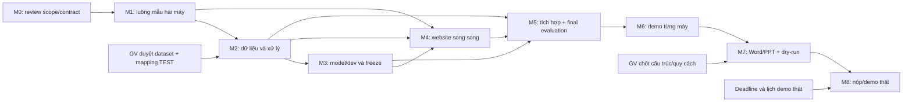

# Master Implementation Plan — đồ án Big Data

Ngày lập kế hoạch **13/10/2026**; đóng review M0 **14/10/2026**. Vai trò: Project Planner và Technical Lead. **M0-T1–M0-T4 đã hoàn tất về tài liệu**, quyết định U-27–U-29 và TV1/TV2 chấp thuận theo xác nhận người dùng U-30. Không cài đặt, viết mã ứng dụng, chạy thử nghiệm hoặc nộp bài trong M0; chưa giao/mở M1.

**Đọc nhanh:** xem bảng milestone, mục 4 về tính khả thi và mục 9 về quyết định cần duyệt. [Checklist ngắn](14_MILESTONE_CHECKLIST.md) dùng khi làm việc; [map 282 Requirement ID](15_REQUIREMENT_MILESTONE_MAP.md) chỉ tra cứu. Các mốc M0–M8, task/AC/QD là mã kế hoạch, không phải Requirement ID hoặc rubric mới.

## 1. Căn cứ và trạng thái thực tế

Căn cứ: [RTM và bảng áp dụng](01_REQUIREMENT_MATRIX.md), [Report Checklist](02_REPORT_STRUCTURE_CHECKLIST.md), [Deliverables](03_DELIVERABLES_CHECKLIST.md), [U-01–U-26](07_CONFIRMED_SCOPE.md), [nghiên cứu](09_TECHNICAL_ADVISORY_RESEARCH.md), [dữ liệu thực tế](10_DATASET_PROFILE.md), [đặc tả](11_SPECIFICATION_DRAFT.md) và [thiết kế đề xuất](12_TECHNICAL_DESIGN.md).

| Đã có bằng chứng hoặc xác nhận | Giới hạn |
| --- | --- |
| Đề tài theo U-01; nhóm 2 người; local/miễn phí/website/nộp một lần | Không có ngày/giờ nộp hoặc lịch demo; không dùng lịch hai giai đoạn cũ. |
| PySpark local + FP-Growth + MongoDB + Spring Boot; MVC/Thymeleaf; chọn giỏ | U-20 chốt batch/nguồn MongoDB/phân tích unique/web đầu ra hoàn chỉnh; chi tiết field/config/versions còn cần kiểm chứng. |
| Cả hai đã học Java/Python/MongoDB/HTML–CSS và chưa học Spark | Chưa đo mức thành thạo; giờ/tuần, khoảng bận và deadline vẫn “chưa rõ” theo U-19. |
| Đã đọc nguồn và khảo sát Online Retail II; audit P-01/P-02 | Đây là Python audit độc lập, không phải pipeline Spark, dataset sạch đã xuất hoặc thành tích runtime của hai laptop. |
| P-01 chỉ giữ dòng đầu; P-02 loại nhóm không phải hàng hóa; P-03 luật vs baseline | U-21 đã chốt loại TEST001/TEST002; K/seed/mốc chia/tham số còn cần lựa chọn có căn cứ. |
| Dataset và khung báo cáo được GV chấp thuận theo người dùng | U-25/U-26: Online Retail II; khung B + quy cách A; chưa đọc thông báo độc lập. Không hỏi lại. |
| Hai máy và vai trò đã chốt | U-22/U-23/U-24: cả hai full run; TV1 data/Spark, TV2 Java/web; Windows 11/RAM 16 GB/50 GB trống theo người dùng, CPU/kiến trúc chưa kiểm tra. |
| Thiết kế/bản đặc tả và kế hoạch đã soạn | Chưa có website, model/metrics final, DB/index, báo cáo Word/PPT đồ án hoặc minh chứng nộp/demo. |

**Không đánh dấu milestone triển khai đã hoàn tất.** Có thể tái dùng tài liệu/audit đã có để giảm công việc, nhưng không lấy chúng thay bằng chứng nghiệm thu sản phẩm.

Sửa truy vết phát hiện khi lập kế hoạch: **B-D11 = dữ liệu thiếu; B-D12 = trùng lặp; B-D13 = ngoại lệ.** Các liên kết P-01/CL-02/DEC-10 và CL-10 được sửa về đúng ID, không sửa yêu cầu nguồn.

## 2. Phạm vi và quyết định kiến trúc

Giữ hai vế: phân tích hành vi từ giao dịch và gợi ý mua kèm theo giỏ. MongoDB lưu nguồn/kết quả, PySpark batch làm sạch/thống kê/FP-Growth/đánh giá, Spring Boot phục vụ website. Tách job batch khỏi web; không thêm Python HTTP service.

Không mở hạng mục JWT/đăng nhập/thanh toán/quản lý đơn, SPA, cloud trả phí, Kafka/streaming, Kubernetes, cluster hai laptop, ALS/LLM/chatbot, RFM hay đồ thị luật. Giới hạn/kiểm tra input, truy vấn an toàn và giữ đúng dữ liệu là công việc cần cho chức năng hiện có, không phải chức năng mới.

### Trade-off ảnh hưởng thiết kế và kế hoạch

| Lựa chọn | Lợi ích | Chi phí/rủi ro | Recommendation |
| --- | --- | --- | --- |
| **Batch riêng + MongoDB + MVC/Thymeleaf** | Web dùng đầu ra khi Spark dừng; giữ stack/Java; không cần API Python riêng. | Contract/manifest/ranking cần kiểm chứng Python–Java. | **Đã chọn hướng theo U-20**, không hỏi lại; kiểm chứng kỹ thuật M1. |
| Spark/job Python chạy từ mỗi request web | Trả kết quả vừa khai phá theo request. | Request phụ thuộc thời gian/RAM job, lỗi/process coordination và không cần cho demo đã chọn. | Không khuyến nghị; không thêm vào task. |
| API Python riêng/SPA riêng | Có thể tách lớp giao diện hoặc inference khi có nhu cầu cụ thể. | Thêm API/triển khai/tích hợp; chưa có lợi ích cần thiết cho scope. | Không dùng trong Master Plan. |
| MongoDB raw source có vị trí + khử trùng bằng Spark | Lineage đầy đủ và chứng minh chọn dòng đầu trong Spark. | Raw archive có lặp nhưng dữ liệu phân tích chỉ một lần; cần đo IO/disk. | **Đã chọn U-20**; nguồn và phân tích phải được phân biệt. |
| Khử trùng khi nhập rồi MongoDB chỉ giữ dòng đầu | Giảm dòng nguồn lưu DB. | Thay contract đã chọn và nguồn bằng chứng xử lý. | Phương án so sánh chưa chọn; không hỏi lại hoặc tự chuyển. |
| Run bất biến + một con trỏ công bố | Tránh web đọc phần ghi dở/lẫn phiên; giữ kết quả cũ khi job lỗi. | Cần manifest, kiểm tra kết thúc ghi, form version và thao tác đổi pointer có điều kiện. | Khuyến nghị; không tự thêm replica set/transaction đa document. |
| Ghi đè trực tiếp vào collection web đang đọc | Ít metadata hơn. | Có thể đọc kết quả dở/lẫn phiên và mất phiên cũ khi lỗi. | Không khuyến nghị vì rủi ro dữ liệu. |
| Decimal text tại biên, Spark decimal, Java BigDecimal | Dễ giữ giá trị qua các runtime; thống kê tiền do Spark tính. | Không sort/range tiền trong DB như chuỗi; scale/conversion cần thử. | Ứng viên trong QD-01/M1. Decimal128 là phương án khác nếu round-trip và nhu cầu truy vấn có căn cứ; chưa tự pin mapper. |

MongoDB ghi nguyên tử ở mức một document; nhiều document không tự nguyên tử. Thiết kế pointer là **đề xuất dựa trên tính chất đó**, chỉ an toàn khi output đã kiểm tra và giữ bất biến. [MongoDB atomicity](https://www.mongodb.com/docs/manual/core/write-operations-atomicity/).

Ưu tiên Windows native; MongoDB 8.0 ghi hỗ trợ Windows 11 x86_64 và không hỗ trợ WSL. Bộ phiên bản phải thử ở M1, không suy tất cả đã tương thích. [MongoDB Windows](https://www.mongodb.com/docs/v8.0/tutorial/install-mongodb-on-windows/).

## 3. Nhân sự, ước lượng và bảng milestone

**Phân công đã chốt theo U-23, đổi vai trò so với đề xuất trước:**
- **TV2 = người còn lại:** lead Spring Boot/MVC/Thymeleaf, hợp đồng dữ liệu/tích hợp, tổng hợp báo cáo và hồ sơ nộp.
- **TV1 = bạn:** lead dữ liệu/PySpark/FP-Growth/đánh giá, viết phần dữ liệu/lý thuyết/kết quả.
- Cả hai học Spark cần dùng, review phần của nhau và demo máy riêng; không chia kiểu “một người hiểu dữ liệu, người kia chỉ hiểu web”. Vai trò đã đổi theo U-23; review chéo và full run từng máy vẫn bắt buộc.

**Đơn vị: giờ-người**, gồm học cần dùng, làm task, review/kiểm tra và viết nháp tại từng mốc. Hai người cùng họp một giờ tính hai giờ-người. Số bên dưới là ước lượng của người lập kế hoạch, chưa có velocity/benchmark, không phải lời cam kết hoặc trọng số.

| Mốc | Thành phẩm/mục tiêu | Phụ thuộc chính | TV1 / TV2 (giờ-người) | Tổng | Trạng thái |
| --- | --- | --- | --- | --- | --- |
| M0 | Chốt phạm vi làm việc và hợp đồng dữ liệu | Hồ sơ 01–12 và U-01–U-30 | 4–6 / 4–6 | 8–12 | Đóng về tài liệu 14/10/2026 theo AC/DoD và review U-30; giờ vẫn là ước lượng |
| M1 | Học Spark cần dùng và kiểm chứng luồng mẫu | M0 đã đóng theo AC/DoD; config cần chuẩn bị | 10–16 / 8–12 | 18–28 | Chưa nghiệm thu |
| M2 | Pipeline dữ liệu và P-01/P-02 | M1; dataset đã được chấp thuận | 22–32 / 10–16 | 32–48 | Chưa nghiệm thu |
| M3 | FP-Growth/baseline và development | M2/policy cuối | 22–32 / 10–16 | 32–48 | Chưa nghiệm thu |
| M4 | Website phân tích/gợi ý | M1 để bắt đầu; M2/M3 để nghiệm thu | 8–12 / 24–36 | 32–48 | Chưa nghiệm thu |
| M5 | Tích hợp và đánh giá cuối | M2/M3/M4; protocol freeze | 12–18 / 12–18 | 24–36 | Chưa nghiệm thu |
| M6 | Full run và demo trên cả hai máy | M5; cả hai FULL_RUN | 12–18 / 12–18 | 24–36 | Chưa nghiệm thu |
| M7 | Báo cáo/slide/dry-run nộp | M5/M6; khung B/quy cách A đã chấp thuận | 10–16 / 14–20 | 24–36 | Chưa nghiệm thu |
| M8 | Nộp/demo/thuyết trình thật | M7; lịch/quy cách thật còn cần | 1–2 / 1–2 | 2–4 | Chưa nghiệm thu |

Tổng cơ sở cập nhật **196–296 giờ-người**: TV1/data **101–152**, TV2/web **95–144**. Thêm 20% dự phòng = khoảng **40–60 giờ-người**, tổng khoảng **236–356 giờ-người** (làm tròn lên). M6 tăng từ 16–24 lên 24–36 vì U-22 yêu cầu full run cả hai; đây là điều chỉnh ước lượng, không số giờ đã đo. Không cộng lại học/viết nháp/kiểm tra đã nằm trong mốc.

M5/M6/M7 đã có **72–108 giờ-người** cho tích hợp/sửa lỗi, kiểm tra hai máy và hoàn thiện hồ sơ; phần dự phòng dành thêm cho lỗi/đổi môi trường/trễ thông tin, không thay các mốc này. M8 là thời gian thao tác/nói/phản biện dự kiến, không gồm chờ lịch lớp; điều chỉnh khi có thời lượng thật.

## 4. Tính khả thi và khung thời gian có điều kiện

**Chưa thể kết luận kịp deadline:** U-19 vẫn chưa có hạn, giờ/tuần và khoảng bận. Khả thi về hướng giải pháp có điều kiện sau M1/M2; đủ RAM/thời gian full run vẫn chưa xác minh.

Khi có lịch, tính:
1. C_A/C_B = tổng giờ khả dụng thật từng tuần của TV1/TV2 từ ngày bắt đầu tới hạn, trừ khoảng bận.
2. So với E_A = 101–152 của TV1 và E_B = 95–144 của TV2, cộng phần dự phòng được phân bổ; không chỉ cộng năng lực hai người rồi bỏ qua người đang trên đường phụ thuộc chính.
3. Lập lịch task theo dependency, thời gian chờ GV/setup/full run và quỹ review. Tổng giờ đủ là điều kiện cần, chưa đủ để nói lịch khả thi.
4. Nếu không đủ, báo phần thiếu và cân đối workload/cách trình bày; không tự cắt chức năng/đánh giá/báo cáo đã yêu cầu.

**Ví dụ công suất, không phải thông tin của nhóm:**

| Giờ/tuần TV1 + TV2 giả định | Cận dưới do công sức 236–356 giờ-người | Giới hạn |
| --- | --- | --- |
| 10 + 10 = 20 | khoảng 12–18 tuần | Chưa cộng chờ thông tin, giới hạn dependency hoặc phân bổ giờ không đều. |
| 15 + 15 = 30 | khoảng 8–12 tuần | Không cam kết lịch nếu người lead dữ liệu/web thiếu giờ vào đúng giai đoạn. |
| 20 + 20 = 40 | khoảng 6–9 tuần | Giả định có thật 40 giờ-người/tuần; không dùng làm deadline mặc định. |

### Khung tham chiếu 7 tuần cho B-P08

B-P08 còn yêu cầu kế hoạch chi tiết 7 tuần; U-08 bỏ nộp giai đoạn 1 **không miễn yêu cầu này**. Khung sau là **phân bổ đề xuất để đối chiếu nguồn**, không chứng minh nhóm có 7 tuần hoặc ghi đây là lịch đã làm. Cần gắn ngày/giờ khả dụng và review với GV nếu thời gian thực khác.

| Tuần tương đối | Trọng tâm dự kiến | Báo cáo/minh chứng song song |
| --- | --- | --- |
| 1 | M0 core và M1; hồ sơ xin duyệt dataset, quyết định thiết kế/roles | Giới thiệu, mục tiêu, scope, lý thuyết nền và môi trường mẫu |
| 2 | M2 pipeline; TV2 bắt đầu M4 từ contract/run mẫu M1 | Schema, quy tắc làm sạch, sơ đồ và nháp giao diện |
| 3 | M2 hoàn tất, M3 baseline/evaluation; M4 tiếp tục | Counts/quality, lý thuyết và giao thức đánh giá |
| 4 | M3 development/freeze; M4 chuyển dữ liệu thật | Bảng cấu hình, kết quả development và phần ứng dụng |
| 5 | M5 tích hợp/final evaluation; freeze feature | Kết quả cuối, so sánh/giải thích/hạn chế |
| 6 | M6 hai máy và M7 review Word/PPT | Vận hành/tái tạo, review số liệu và cấu trúc/format |
| 7 | M7 hoàn thiện/dry-run; M8 chỉ nếu lịch GV nằm ở tuần này | TOC/caption, gói nộp, receipt thật khi nộp |

Để toàn công sức 236–356 giờ-người nằm trong 7 tuần cần khoảng **34–51 giờ-người/tuần của nhóm**, cộng đủ thời gian chờ/dependency; chưa biết nhóm đáp ứng. Nếu hạn chỉ cho 7 tuần và năng lực thấp hơn, lịch này **chưa được chứng minh khả thi**.

Lịch của B có tìm dataset muộn hơn baseline và hai giai đoạn cũ; kế hoạch hiện tại sắp **dataset → xử lý → baseline/evaluation** theo dependency kỹ thuật, giữ nguồn/lịch cũ để truy vết. Không lập báo cáo tiến độ giai đoạn 1.

## 5. Dependency map và cổng chuyển mốc

M1→M4 cho phép **bắt đầu** bằng mẫu; M2/M3→M4 là dependency để **nghiệm thu bằng dữ liệu thật**, không bắt TV2 ngồi chờ cả nhánh dữ liệu. Báo cáo viết từ M0 xuyên suốt, M7 chỉ tổng hợp/final QA. Đường chính dự kiến: M0 core→M1→M2→M3→M5→M6→M7→M8; M4 cũng có thể thành bottleneck, phải cập nhật khi có giờ thật.

| Cổng | Điều kiện | Chặn phần nào / việc vẫn làm được |
| --- | --- | --- |
| G-ARCH | U-20/U-23 chốt hướng/roles, U-27–U-29 chốt M0-D1/D2/D3; TV1/TV2 chấp thuận contract theo U-30 | Cổng review M0 đã đạt; M1 vẫn cần giao việc phù hợp. Không coi tài liệu là schema/runtime đã tạo. |
| G-DATA | U-25 duyệt dataset theo người dùng; U-21 loại TEST; mapping/version cần hoàn thiện kỹ thuật | Không còn chờ hỏi GV/TEST; M2 vẫn phải kiểm chứng policy/runtime và freeze. |
| G-SPLIT | K/seed/mốc chia/cấu hình freeze bằng development | Trước final evaluation M5; không tự dùng test cuối để chọn. |
| G-TWO | Receipt môi trường và demo riêng từng máy | Trước đóng M1/M6 theo phạm vi; một máy PASS không thay cả hai. |
| G-REPORT | U-26 chốt khung B + quy cách A | Không còn chờ chọn A/B; M7 kiểm tra Word thật, in/trang bổ sung giữ điều kiện. |
| G-SUBMIT | Gói M7 và deadline/quy cách thật | Trước M8 actual upload/demo; dry-run không thay receipt thật. |

## 6. Quy tắc nghiệm thu chung

AC là điều kiện kiểm tra đề xuất bám nguồn/U; DoD là cách xác nhận một mốc đã làm xong. Không tự tạo ngưỡng tốc độ/độ chính xác/điểm số.

Một milestone chỉ đóng khi:
- Deliverable đúng scope và Requirement ID có evidence phù hợp với lần chạy/phần nội dung thật; ghi rõ phần conditional/N/A và căn cứ.
- Reviewer người còn lại kiểm tra, lỗi ảnh hưởng dữ liệu/ranking/vận hành được giải quyết; giới hạn còn lại được công khai.
- Ghi source hash, policy/run/config/môi trường/cách tái tạo khi có runtime; tài liệu cập nhật đúng cái đã làm.
- Không dùng fixture, audit Python, /health, build xanh hoặc ảnh trang tĩnh thay real integration/dataset/full run/two-machine acceptance.
- Không tự tính điểm bằng số checkbox. Không ghi contribution theo giờ dự kiến; contribution/lịch nhóm lấy từ công việc thật.
- Quyết định lớn thay schema/kiến trúc/protocol/scope phải review trước; lựa chọn implementation nhỏ trong phạm vi đã duyệt do người phụ trách quyết định và ghi nếu cần.

## 7. Milestone chi tiết

### M0 — Chốt phạm vi làm việc và hợp đồng dữ liệu

**Mục tiêu/phạm vi:** Review thiết kế file 12, thống nhất phân công/ranh giới dữ liệu và ghi các cổng xác nhận. Không cài stack, tạo DB hoặc thay P-01/P-02/P-03 trong mốc này.

**Requirement ID:** B-G01–B-G07; B-S01–B-S07; B-T01–B-T06; B-P06–B-P08; B-O07/B-O08; U-09–U-26. Các nghĩa vụ thiết kế hiện có được review, không mặc định đã nghiệm thu.

**Phụ thuộc và công sức:** Hồ sơ 01–12 và U-01–U-30; không phải yêu cầu làm lại khảo sát. Tổng 8–12 giờ-người; TV1 4–6, TV2 4–6 là ước lượng, không phải giờ đã làm. Contract M0 đã nghiệm thu về tài liệu theo receipt U-30, chưa runtime.

| Task | Công việc | Người phụ trách / review | Thứ tự phụ thuộc |
| --- | --- | --- | --- |
| M0-T1 | Đối chiếu scope/hiện trạng và quyết định đã chốt; sửa lỗi truy vết nếu phát hiện. | TV2; TV1 review | Hồ sơ hiện có |
| M0-T2 | Chọn kiến trúc/collection/kiểu tiền–ngày–ID, dữ liệu nguồn vs dữ liệu phân tích, manifest/công bố và các KPI/màn hình tối thiểu. | TV2 + TV1; người dùng duyệt lựa chọn lớn | M0-T1; QD-01 |
| M0-T3 | Ghi nhận dataset được chấp thuận theo người dùng; cập nhật mapping loại TEST và hồ sơ xác nhận đã có, không xin duyệt lại. | TV1; TV2 review | U-21/U-25 |
| M0-T4 | Cập nhật vai trò đã đổi và full run cả hai; lịch ngày/giờ còn chưa rõ, lưu trạng thái/decision log. | TV1 + TV2 | U-22/U-23; QD-07 còn mở |

**Kiến thức/tài nguyên:** Đọc phần đầu/cuối file 11/12; phân biệt tuple tám giá trị với khóa hóa đơn; nguồn hash và audit file 10; checklist báo cáo 02/đầu ra 03.

**Deliverable/cách kiểm chứng:** Thiết kế/đặc tả đã review với quyết định rõ, bảng phân công dự kiến, hồ sơ xác nhận dataset U-25 đã có và decision log. Kiểm chứng bằng đối chiếu từng quyết định với U/RTM; không dùng sự tồn tại file 12 làm bằng chứng người dùng đã duyệt.

**Acceptance Criteria:**
- M0-AC1: Không thêm tính năng ngoài scope; giữ U-16 chỉ một dòng đầu và U-17/U-18.
- M0-AC2: Quy ước input/output, tiền/ngày/ID và trách nhiệm writer/web có kết luận; người dùng chấp thuận các lựa chọn lớn.
- M0-AC3: U-25/U-26 được ghi đúng là xác nhận người dùng về GV; deadline/năng lực còn chưa rõ, không coi là runtime hoặc cam kết lịch.

**Definition of Done:** TV1/TV2 review hợp đồng kỹ thuật; QD-01/QD-04 và full run QD-03 đã có kết luận. QD-05/QD-06 đã giải quyết theo người dùng, không yêu cầu xin duyệt lại; ghi đúng nguồn U-25/U-26, không khẳng định đã đọc thông báo độc lập. QD-07 lịch còn mở.

**Rủi ro/blocker/phê duyệt:** Hướng thiết kế/TEST/phân công đã chốt; hợp đồng kỹ thuật và runtime chưa kiểm chứng. Dataset đã được chấp thuận theo U-25; M2 còn kiểm chứng policy/runtime, không còn chờ duyệt dataset. Lịch chưa rõ chặn kết luận kịp hạn.

**Báo cáo/minh chứng tại mốc:** Viết giới thiệu/mục tiêu/phạm vi, lý do chọn stack; mở bảng lịch nhóm/công việc. Lưu xác nhận và sơ đồ đề xuất, ghi đúng trạng thái chưa runtime.

#### Kết quả chuẩn bị review M0 ngày 14/10/2026

Agent hoàn thiện và đối chiếu tài liệu; TV1/TV2 đã review, chấp thuận bản hiện tại **theo xác nhận người dùng U-30**, không gán việc sửa của Agent cho thành viên. [File 11 mục 8–10](11_SPECIFICATION_DRAFT.md) chứa bối cảnh/mục tiêu, mapping TEST và KPI; [file 12 mục 9–13](12_TECHNICAL_DESIGN.md) chứa contract input/output/khóa/kiểu/manifest/công bố/lỗi/kiểm chứng, version m0-contract-v1. [File 07](07_CONFIRMED_SCOPE.md) ghi lựa chọn U-27–U-29 và xác nhận review U-30. Receipt AC/DoD/đóng M0 ở [checklist 14](14_MILESTONE_CHECKLIST.md).

| Task | Kết quả tài liệu hiện có | Phần cần người thật/kiểm chứng |
| --- | --- | --- |
| M0-T1 | Đối chiếu U/RTM/report/deliverables/map; bổ sung bài toán/bối cảnh/mục tiêu/giá trị ở file 11. Giữ 282 ID/rubric; nguồn không bị sửa. | TV1/TV2 chấp thuận theo U-30; không kết luận đạt CLO khi nguồn thiếu định nghĩa, chưa tick nghĩa vụ sản phẩm/report. |
| M0-T2 | Hoàn thiện nguồn vs phân tích, ID/tiền/ngày, collection/manifest/pointer, query/ranking/lỗi/KPI; U-27–U-29 chốt chín collection/run bất biến/con trỏ, decimal text, dashboard hàng hóa + audit. | TV1/TV2 chấp thuận toàn contract theo U-30; M1 thử kiểu/mapper/config, nghiệm thu tài liệu không thay runtime. |
| M0-T3 | Ghi mapping loại TEST001/TEST002 theo U-21 và căn cứ P-02; giữ U-25/U-26 là xác nhận người dùng về GV. | Counts mới chờ M2; không chạy lại dataset ở M0, không biến audit cũ thành Spark evidence. |
| M0-T4 | Giữ TV1 data/Spark, TV2 Java/web, review chéo và full run mỗi máy; QD-07/QD-09 còn chưa rõ. | Review contract hai người có receipt U-30; chưa có giờ/phần trăm đóng góp, không suy từ vai trò hoặc ước lượng. |

**Lịch/công việc để cập nhật vào báo cáo B-R02/B-R03/B-O07/B-O08:** khung ghi nhận ở đây phục vụ M0, không là báo cáo Word đã soạn. Khi có việc thật điền ngày/tuần, người, công việc, evidence và reviewer; không lấy effort ước lượng làm giờ đã làm.

| Ngày/tuần thực tế | Người | Công việc dự kiến hoặc đã ghi nhận | Evidence/review | Đóng góp thực tế |
| --- | --- | --- | --- | --- |
| 14/10/2026, ngày ghi nhận xác nhận | TV1 | Vai trò U-23; đã review và chấp thuận contract phía data theo U-30 | Receipt ở checklist 14; công việc triển khai/giờ thực tế chưa có | Chưa có tỷ lệ/giờ được xác nhận |
| 14/10/2026, ngày ghi nhận xác nhận | TV2 | Vai trò U-23; đã review và chấp thuận contract phía web theo người dùng U-30 | Receipt ở checklist 14; chưa nhận thông báo trực tiếp riêng TV2, không gán sửa tài liệu của Agent cho TV2 | Chưa có tỷ lệ/giờ được xác nhận |

**Ranh giới bàn giao:** M0 đủ AC/DoD và đóng về tài liệu ngày 14/10/2026 theo U-30. Không cần runtime PASS để đóng review M0; Agent dừng sau bàn giao, chưa mở M1 khi chưa được giao. QD-07 lịch vẫn mở, không cam kết kịp hạn.

### M1 — Học Spark cần dùng và kiểm chứng luồng mẫu trên hai máy

**Mục tiêu/phạm vi:** Chứng minh một lát cắt nhỏ MongoDB → PySpark/FP-Growth → MongoDB → trang MVC/Thymeleaf. Dùng giỏ tự tạo có đáp án để tránh phụ thuộc duyệt dataset; chưa xây đầy đủ dashboard.

**Requirement ID:** B-G07; B-T01/B-T02/B-T04; B-E01/B-E04/B-E05/B-E06; B-H02–B-H07 theo lựa chọn U-09; B-O05/B-O06; U-12/U-13/U-15.

**Phụ thuộc và công sức:** M0 đã đóng theo AC/DoD, gồm review hợp đồng dữ liệu; thu thập thông tin môi trường từng máy khi chuẩn bị M1. Tổng 18–28 giờ-người; TV2 8–12, TV1 10–16.

| Task | Công việc | Người phụ trách / review | Thứ tự phụ thuộc |
| --- | --- | --- | --- |
| M1-T1 | Cả hai học driver/partition/action/shuffle/schema/window và ví dụ support/confidence/lift; giải thích cho nhau. | TV2 + TV1 | M0-T2 |
| M1-T2 | Kiểm tra/cài bộ phiên bản ứng viên, Windows x64, Java/Python/Scala/connector/MongoDB/Boot; ghi receipt riêng mỗi máy. | TV1 phụ trách Python/Spark; TV2 Java/web | M1-T1; chỉ thực hiện khi được giao triển khai |
| M1-T3 | Chạy mẫu nhỏ: ghi/read ID/null/ngày/tiền/array; làm sạch và FP-Growth đối chiếu tính tay; ghi kết quả MongoDB. | TV1; TV2 kiểm tra mapping Java | M1-T2 |
| M1-T4 | Trang Thymeleaf đọc cùng run mẫu, hiện luật/gợi ý cơ bản; người kia lặp lại theo hướng dẫn. | TV2; TV1 xác minh máy còn lại | M1-T3 |

**Kiến thức/tài nguyên:** KG-05/06/08/09/10/12/13 và SRC chính thức trong file 09; 5 giỏ minh họa; mẫu kiểu dữ liệu; mạng tải phụ thuộc/đĩa. Các phiên bản file 09 là ứng viên, không là bộ đã tương thích.

**Deliverable/cách kiểm chứng:** Prototype mẫu, log/version receipt hai máy, hướng dẫn setup/run ban đầu, đáp án toán học và kết quả round-trip. Chạy trên mẫu thật của prototype, không lấy file audit Python làm bằng chứng Spark.

**Acceptance Criteria:**
- M1-AC1: Spark đọc/ghi MongoDB và Java đọc đúng ID/null/array/tiền/ngày theo hợp đồng.
- M1-AC2: Tập phổ biến/luật mẫu khớp tính tay; không gọi HTTP làm fit lại.
- M1-AC3: Hai receipt riêng xác nhận luồng mẫu; một máy PASS không đóng M1 cho hai máy.

**Definition of Done:** Bộ phiên bản được ghi và thử; source mẫu/hướng dẫn đủ để thành viên kia chạy; lỗi còn mở và giới hạn mẫu được ghi. Chưa kết luận full dataset đủ RAM hoặc chính thức có chất lượng tốt.

**Rủi ro/blocker/phê duyệt:** Connector/Scala và dependency mismatch, native Windows hoặc môi trường máy 2 chưa biết. Chẩn đoán bằng lỗi; không thêm WSL/cluster/replica set hoặc đổi stack âm thầm; vượt phương án đã duyệt phải quay QD-01.

**Báo cáo/minh chứng tại mốc:** Ghi môi trường cài đặt thực tế và lý thuyết đã hiểu; ảnh/log luồng mẫu ghi rõ là mẫu, chưa dùng làm kết quả dataset cuối.

### M2 — Xây pipeline dữ liệu và kiểm chứng P-01/P-02 trên nguồn đầy đủ

**Mục tiêu/phạm vi:** Nhập dữ liệu có lineage, Spark khử trùng/lọc/chuẩn hóa, tạo giỏ và thống kê có mẫu số. Cố định basket set/chính sách làm sạch; không chọn mô hình bằng dữ liệu kiểm tra cuối.

**Requirement ID:** B-D01–B-D15; B-T01/B-T02/B-T04; B-E02/B-E05/B-E06; B-H01–B-H04/B-H08; B-P16–B-P19/B-P27/B-P28 theo cách hiểu phù hợp FP-Growth; B-O02.

**Phụ thuộc và công sức:** M1; U-25 đã xác nhận duyệt dataset; U-21 chốt loại TEST, mapping kỹ thuật hoàn thiện trước đóng băng. Tổng 32–48 giờ-người; TV2 10–16, TV1 22–32.

| Task | Công việc | Người phụ trách / review | Thứ tự phụ thuộc |
| --- | --- | --- | --- |
| M2-T1 | Nhập nguồn bất biến và vị trí dòng; hash/header/count, retry/idempotency theo thiết kế đã chọn. | TV1; TV2 review schema | M1; QD-05 |
| M2-T2 | Spark chỉ giữ dòng đầu cho tuple tám giá trị; kiểm tra thứ tự partition khác vẫn cùng dòng nguồn; dữ liệu thiếu, hủy/điều chỉnh, giá/số lượng, ngoại lệ. | TV1; TV2 review đối chiếu | M2-T1 |
| M2-T3 | Áp dụng mapping P-02 và quyết định TEST; gom giỏ, danh mục/nhãn, thời điểm đại diện; giữ số lượng/giá ở dữ liệu dòng hàng. | TV1; TV2 review nghiệp vụ | M2-T2; QD-02 |
| M2-T4 | Sinh summaries/quality manifest và bộ dữ liệu sau tiền xử lý; đo RAM/đĩa/thời gian theo bước và kiểm tra số liệu. | TV1; TV2 kiểm tra bảng/biểu đồ mẫu | M2-T3 |

**Kiến thức/tài nguyên:** KG-02/03/04/06/09/10; audit nguồn và policy đã có; cửa sổ chọn dòng đầu; decimal scale và local datetime; mapping có version.

**Deliverable/cách kiểm chứng:** Pipeline Spark, basket set/đầu ra tiền xử lý và manifest số dòng từng bước; bảng lỗi/mẫu số; nguồn/link và bằng chứng duyệt dataset. Kiểm chứng bằng nguồn cố định, audit độc lập và vài hóa đơn tính tay.

**Acceptance Criteria:**
- M2-AC1: Trước lọc khác, P-01 đúng 1.067.371 − 34.335 = 1.033.036 với source hash hiện tại; chọn đúng dòng đầu, không mất dòng chỉ khác giá/số lượng.
- M2-AC2: Không loại theo Customer ID thiếu mặc định; không gộp item theo tên; mapping và lý do xử lý ngoại lệ/inconsistency được ghi.
- M2-AC3: Giỏ unique item, dữ liệu chất lượng và thống kê khớp đối chiếu; số sau P-02 tính lại theo mapping/TEST cuối, không ép khớp số ứng viên cũ.

**Definition of Done:** TV2 review; raw source không bị sửa; lineage/hướng dẫn tái tạo đầu ra và counts rõ; xác nhận dataset U-25 đã được ghi. Chưa gọi FP-Growth/metrics PASS chỉ vì sạch dữ liệu.

**Rủi ro/blocker/phê duyệt:** Sai khóa/dedup hoặc làm tròn tiền; giỏ lớn 1.108 item là cảnh báo tài nguyên của ứng viên, không lý do tự cắt. TEST ảnh hưởng counts; QD-05/QD-02 đã giải quyết; policy/runtime còn cần kiểm chứng trước freeze, các thử mẫu vẫn độc lập.

**Báo cáo/minh chứng tại mốc:** Hoàn thành phần dữ liệu và tiền xử lý: nguồn/quy mô/schema/đặc trưng Big Data thật, bảng trước–sau, lý do xử lý và phân phối giỏ. Ghi counts/runtime đúng từng lượt.

### M3 — FP-Growth, baseline và đánh giá trên phần phát triển

**Mục tiêu/phạm vi:** Xây khai phá/gợi ý/đánh giá theo P-03; thử cấu hình trên lịch sử và phần phát triển. Đóng băng K/seed/mốc chia/tham số/ranking trước đánh giá cuối M5; không mở tập cuối để chọn cấu hình.

**Requirement ID:** B-T06; B-E01–B-E06; B-V01–B-V05 ở mức phát triển; B-H05/B-H06/B-H09; B-P09–B-P14; B-R06; U-18.

**Phụ thuộc và công sức:** M2; basket set/cleaning policy ổn định. Tổng 32–48 giờ-người; TV2 10–16, TV1 22–32.

| Task | Công việc | Người phụ trách / review | Thứ tự phụ thuộc |
| --- | --- | --- | --- |
| M3-T1 | Cố định split theo hóa đơn/thời gian, K/seed và mask một item; kiểm tra giao tập/leakage; định nghĩa mẫu số metrics. | TV1; TV2 review | M2; QD-08 |
| M3-T2 | Fit FP-Growth trên lịch sử; baseline theo số giỏ; bảo đảm tập/luật, dữ liệu catalog và ranking dùng nguồn lịch sử được phép. | TV1 | M3-T1 |
| M3-T3 | Đánh giá thủ công các ca rỗng/tie/item mới, ứng viên đã có, tiền đề nhiều item; đối chiếu Recall@K/tỷ lệ có gợi ý. | TV1; TV2 dùng cùng ca cho Java | M3-T2 |
| M3-T4 | Thử cấu hình có căn cứ trên phần phát triển, đo chi phí/độ phủ; chọn cấu hình, freeze manifest và cung cấp run mẫu thật cho web. | TV1; TV2 review | M3-T3 |

**Kiến thức/tài nguyên:** KG-05/07/11/13; source FP-Growth và ranking chính thức; ví dụ tính tay; test case chung Python/Java; hiểu minConfidence không giảm chi phí fit.

**Deliverable/cách kiểm chứng:** Job/model outputs, baseline và evaluation harness, kết quả phát triển, cấu hình đã freeze và các ca gợi ý chung. Nhãn kết quả là development, chưa là final.

**Acceptance Criteria:**
- M3-AC1: Tiền đề đủ, loại item đã có và ứng viên trùng; ranking confidence/lift/support/tie nhất quán; không fallback mặc định.
- M3-AC2: Luật và baseline cùng truy vấn/catalog/K và dữ liệu lịch sử; giỏ một item, item mới và không có luật được tính/báo đúng.
- M3-AC3: Thông số chọn bằng development, test cuối chưa dùng; không yêu cầu FP-Growth thắng baseline hoặc đạt điểm tự đặt.

**Definition of Done:** TV2 tính lại mẫu metrics và review split; lưu configuration/source/policy version; khoa học và runtime phát triển truy vết được. Final evaluation vẫn mở ở M5.

**Rủi ro/blocker/phê duyệt:** Bùng số tập/luật, ít luật hoặc recall thấp, leakage. Đo và điều chỉnh tham số trên development; không dùng test để chữa điểm thấp, không tự thêm ALS/LLM hoặc đổi dataset.

**Báo cáo/minh chứng tại mốc:** Viết lý thuyết FP-Growth/ví dụ và giao thức đánh giá; lưu bảng tham số/so sánh phát triển và lý do chọn. Chừa phần kết quả cuối, không điền bằng số giả.

### M4 — Website phân tích và gợi ý theo giỏ

**Mục tiêu/phạm vi:** Hoàn thiện ba khu vực phân tích, luật và chọn giỏ trên Spring MVC/Thymeleaf; web chỉ đọc run kết quả, Java áp dụng ranking đã chọn. Không xây website bán hàng.

**Requirement ID:** B-F01/B-F02; B-H07–B-H09; B-R07/B-R08; B-P20; B-E07; B-O01; U-03/U-11/U-12.

**Phụ thuộc và công sức:** M1 và hợp đồng M0 để làm song song M2/M3; M2/M3 cung cấp dữ liệu thật trước nghiệm thu M4. Tổng 32–48 giờ-người; TV2 24–36, TV1 8–12.

| Task | Công việc | Người phụ trách / review | Thứ tự phụ thuộc |
| --- | --- | --- | --- |
| M4-T1 | Làm model đọc/DTO nội bộ/template theo hợp đồng và run mẫu M1; fixture chỉ dùng phát triển, ghi rõ. | TV2; TV1 xác nhận fields | M1/M0-T2 |
| M4-T2 | Dashboard, summaries và bảng luật: scope/mẫu số, lọc/phân trang, trạng thái rỗng/chưa có dữ liệu. | TV2; TV1 đối chiếu số liệu | M4-T1; dữ liệu thật M2/M3 để xác minh |
| M4-T3 | Giỏ một/nhiều item, validate catalog, đầy đủ tiền đề, khử trùng ứng viên/ranking và giải thích. | TV2; TV1 kiểm tra parity | M4-T1; ca và ranking M3 |
| M4-T4 | Kiểm tra input/rendering/query và form version, lỗi MongoDB/công bố, Spark dừng mà web vẫn dùng kết quả; nối dữ liệu thật. | TV2; TV1 review | M4-T2/M4-T3; run thật M3 |

**Kiến thức/tài nguyên:** KG-10/11/12; Spring MVC/Data MongoDB/Thymeleaf; sơ đồ/contract và test case chung; chọn chart miễn phí đơn giản khi cần.

**Deliverable/cách kiểm chứng:** Website nguồn và bộ ca UI/query/gợi ý với dữ liệu thật; ảnh chứa run/source/scope; hướng dẫn thao tác. Không chấp nhận chỉ fixture UI làm đạt yêu cầu thực nghiệm.

**Acceptance Criteria:**
- M4-AC1: Ba nhóm thông tin đã đồng ý hiển thị và có ý nghĩa, mã/tên và scope không gây nhầm; không gọi fit theo request.
- M4-AC2: Giỏ có A nhưng thiếu B không áp dụng {A,B}→C; không trả item đã chọn; không có luật hiển thị đúng và ranking khớp ca chung.
- M4-AC3: Dữ liệu thật cùng run; input invalid được xử lý, tên/mô tả được render an toàn; query không nhận object truy vấn từ browser.

**Definition of Done:** TV1 kiểm tra trực tiếp UI và đối chiếu với đầu ra; hướng dẫn demo/ảnh có provenance. Chưa coi hai máy đầy đủ PASS trước M6.

**Rủi ro/blocker/phê duyệt:** Đợi dữ liệu thật hoặc lệch Python–Java; làm template nhiều hơn dự kiến. Phát triển bằng run mẫu M1, chuyển sang thật trước ký AC; không tự thêm SPA/auth/payment.

**Báo cáo/minh chứng tại mốc:** Viết phần xây dựng ứng dụng và trực quan hóa; ảnh thật, sơ đồ tương tác, giải thích các case có/không có gợi ý; ghi lỗi/giới hạn thay vì chỉ ảnh đẹp.

### M5 — Tích hợp, công bố an toàn và đánh giá cuối

**Mục tiêu/phạm vi:** Đóng luồng end-to-end với source thật, publication/version/retry; so sánh cuối trên tập giữ lại và sửa lỗi tích hợp. Freeze feature để dành thời gian cho M6/M7.

**Requirement ID:** B-E01–B-E07; B-V01–B-V05; B-T03/B-T04; B-H08/B-H09; B-O01; DEL-13/DEL-14/DEL-16.

**Phụ thuộc và công sức:** M2/M3/M4 hoàn tất AC; cấu hình/model/evaluation protocol đã freeze. Tổng 24–36 giờ-người; TV2 12–18, TV1 12–18.

| Task | Công việc | Người phụ trách / review | Thứ tự phụ thuộc |
| --- | --- | --- | --- |
| M5-T1 | Chạy end-to-end source→MongoDB→Spark→run→web, kiểm tra manifest/schema/count/catalog/rule. | TV1 chạy batch; TV2 kiểm tra web | M2/M3/M4 |
| M5-T2 | Thử ghi dở/lỗi/ retry/run mới và form cũ trên dữ liệu thử riêng; giữ pointer/run hiện hành khi thất bại. | TV2 + TV1 | M5-T1; thiết kế QD-01 |
| M5-T3 | Chạy đánh giá cuối chỉ sau freeze, lưu predictions/metrics/coverage/resource và nhận xét so với baseline. | TV1; TV2 tính lại mẫu và review | M3-T4; M5-T1 |
| M5-T4 | Sửa lỗi tích hợp ảnh hưởng dữ liệu/ranking/query; chạy regression liên quan, chốt build/run dùng báo cáo và demo. | TV2 + TV1 | M5-T2/M5-T3 |

**Kiến thức/tài nguyên:** Run manifest/active pointer, atomic single document, mapping/query parity và chiến lược retry; bộ ca cố định, split/seed/K đã freeze.

**Deliverable/cách kiểm chứng:** Run thật hoàn chỉnh, kết quả final và baseline, bug log/resolution, bằng chứng công bố thất bại không làm mất phiên cũ; bản freeze để M6/M7 sử dụng.

**Acceptance Criteria:**
- M5-AC1: Mọi trang/request dùng một run/scope nhất quán; không nhìn đầu ra ghi dở; retry không nhân bản kết quả.
- M5-AC2: Final metrics tái tính được và được phân tích dù thấp; không dùng kết quả final để chọn lại cấu hình rồi gọi đó là test độc lập.
- M5-AC3: Không còn lỗi đã biết làm sai số liệu/gợi ý hoặc ngăn demo; giới hạn nhỏ khác được ghi rõ.

**Definition of Done:** Hai người review run/metrics và lỗi đã sửa; có chỉ dẫn chạy từ nguồn đến web. Nếu sửa logic làm thay model/kết quả, ghi test đã bị tiếp xúc và xử lý giao thức minh bạch trước chạy lại, không giấu leakage.

**Rủi ro/blocker/phê duyệt:** Kiểu/schema hoặc publication lỗi, metrics giữa runtime khác nhau; quyền chạy test/đổi cấu hình. Thời gian sửa lỗi đã nằm trong effort và contingency chung, không đẩy toàn bộ sang cuối.

**Báo cáo/minh chứng tại mốc:** Điền phần kết quả cuối, so sánh/giải thích/hạn chế; ảnh/chart/log từ run freeze; cập nhật kiến trúc theo hệ thống đã làm thực tế.

### M6 — Full run và demo trên cả hai máy

**Mục tiêu/phạm vi:** Mỗi người tự chạy toàn pipeline trên nguồn đầy đủ theo config freeze, giữ fit train/đánh giá theo P-03, rồi mở web trên máy mình. Receipt/tài nguyên từng máy, không chỉ đối chiếu snapshot imported.

**Requirement ID:** B-O02/B-O05/B-O06; B-E04/B-E07; B-N03; U-15; DEL-21/DEL-22/DEL-30.

**Phụ thuộc và công sức:** M5; chế độ demo QD-03 đã chốt; từng máy có phần mềm/tài nguyên phù hợp. Tổng 24–36 giờ-người; TV1 12–18, TV2 12–18.

| Task | Công việc | Người phụ trách / review | Thứ tự phụ thuộc |
| --- | --- | --- | --- |
| M6-T1 | Hoàn thiện hướng dẫn full pipeline từ nguồn và config freeze trên từng máy; output export chỉ hỗ trợ đối chiếu, không thay full run. | TV2 hướng dẫn web; TV1 nguồn/job | M5; U-22 |
| M6-T2 | TV1/người dùng tự nhập toàn nguồn, xử lý/fit train/đánh giá và mở web trên máy mình; ghi receipt/tài nguyên. | TV1 thực hiện; TV2 review | M6-T1 |
| M6-T3 | TV2 tự lặp full pipeline trên máy mình, đối chiếu cùng policy/config/source và kết quả; ghi receipt/tài nguyên riêng. | TV2 thực hiện; TV1 review | M6-T1; độc lập M6-T2 |
| M6-T4 | Sửa hướng dẫn/lỗi phụ thuộc, start/stop/lỗi kết nối; thử lại phần ảnh hưởng và diễn tập luồng demo. | TV2 + TV1 | M6-T2/M6-T3 |

**Kiến thức/tài nguyên:** Cấu hình hai máy, gói nguồn/run, network khi setup; snapshot manifest; không xóa môi trường/database hiện có để tạo cảm giác clean install.

**Deliverable/cách kiểm chứng:** Hai receipt demo thật, hướng dẫn đã được người kia kiểm tra, ghi mode FULL_RUN và log các bước trên từng máy đúng thực tế và lỗi/giới hạn; kịch bản demo.

**Acceptance Criteria:**
- M6-AC1: Cả hai máy web + MongoDB dùng đúng output, không cần Spark đang chạy để thao tác; không chỉ một ảnh/health check.
- M6-AC2: Giỏ/ranking/statistics khớp snapshot; từng người giải thích phần mình và luồng chung.
- M6-AC3: **U-22 yêu cầu receipt FULL_RUN của cả hai**; không dùng imported output hoặc chỉ sample để đóng mốc.

**Definition of Done:** Hướng dẫn sửa sau người thứ hai chạy; start/demo/stop được thử đúng phạm vi; môi trường/lỗi còn lại được ghi. Phân biệt diễn tập ở đây với buổi thuyết trình thật M8.

**Rủi ro/blocker/phê duyệt:** Máy 2 yếu/thiếu disk, config drift, chưa có quyền cài hoặc mất mạng setup. Import output không thay yêu cầu full run U-22; nếu máy không chạy được, báo lỗi/tài nguyên và xử lý, không tự hạ tiêu chí.

**Báo cáo/minh chứng tại mốc:** Ghi cách vận hành, cấu hình và minh chứng từng máy; bổ sung phần hạn chế tài nguyên/tái lập và hướng dẫn cài/chạy.

### M7 — Hoàn thiện báo cáo, slide và thử quy trình nộp

**Mục tiêu/phạm vi:** Tổng hợp bản nháp đã viết song song thành Word/PPT, kiểm tra cấu trúc/định dạng/đóng góp và gói bài; diễn tập mở file và cách nộp, chưa tự gửi Classroom.

**Requirement ID:** B-R01–B-R12; B-O01–B-O08; B-P21–B-P26/B-P29–B-P32; B-A01–B-A04; A-S01–A-S34/A-C01–A-C31/A-F001–A-F067 theo điều kiện áp dụng; B-N02/B-N05–B-N07.

**Phụ thuộc và công sức:** M5/M6 và cổng cấu trúc báo cáo QD-06; viết nháp bắt đầu từ M0, không chờ M7. Tổng 24–36 giờ-người; TV2 14–20, TV1 10–16.

| Task | Công việc | Người phụ trách / review | Thứ tự phụ thuộc |
| --- | --- | --- | --- |
| M7-T1 | Chốt outline A/B theo GV, điền thông tin bìa, lịch nhóm và đóng góp theo thực tế; hợp nhất bản nháp. | TV2 tổng hợp; TV1 phần dữ liệu/lý thuyết | Bản nháp M0–M6; QD-06 |
| M7-T2 | Đối chiếu từng yêu cầu báo cáo, caption/styles/TOC/page sections/citations, chính tả và số liệu với run freeze. | TV2; TV1 review nội dung/số liệu | M7-T1; M5/M6 |
| M7-T3 | Slide/problem–data–method–results–limits, tập nói và Q&A; cả hai giải thích và thao tác demo. | TV2 + TV1 | M7-T1; kết quả M5/M6 |
| M7-T4 | Thử mở Word/PPT/source/data-link và làm theo hướng dẫn từ gói sẵn sàng nộp; kiểm tra quy cách Classroom/dung lượng/hạn khi GV công bố. | TV1 kiểm tra gói; TV2 tổng hợp sửa | M7-T2/M7-T3; QD-09 |

**Kiến thức/tài nguyên:** Checklist 02/03; outline đã chốt, danh sách người thật, run freeze, tài liệu nguồn trích dẫn; Word/PPT app để mở/kiểm tra render. Không tự áp cấu trúc năm chương A nếu chưa được xác nhận.

**Deliverable/cách kiểm chứng:** Word/PPT hoàn chỉnh, mã nguồn/data hoặc link/hướng dẫn và bảng đóng góp; checklist mở file/gói nộp; script lời nói/kịch bản demo và câu phản biện. Dạng .docx/.pptx/ZIP nếu dùng là đề xuất cần phù hợp chỉ dẫn GV.

**Acceptance Criteria:**
- M7-AC1: Đủ các phần B-R01–B-R12 khi áp dụng; A được kiểm theo phạm vi đã chốt, không sao chép số trang/logo/danh mục mẫu như thật.
- M7-AC2: Word/PPT/source/hướng dẫn mở được; nội dung/số liệu và ảnh cùng run, trích nguồn và đóng góp đúng thực tế.
- M7-AC3: Có diễn tập nộp/tài liệu, kịch bản trình bày; không coi dry-run là đã nộp hoặc đã thuyết trình.

**Definition of Done:** Hai người đọc/review bản cuối, update TOC/caption/page numbers; gói release có manifest và checklist không còn thiếu đầu ra bắt buộc. Classroom và buổi thật còn để M8.

**Rủi ro/blocker/phê duyệt:** Khung B/quy cách A đã chốt; còn rủi ro chính tả/format/số liệu lệch, cuối kỳ mới viết báo cáo, link hỏng hoặc Classroom giới hạn. Dành thời gian M7 riêng và giữ contingency, không đánh đổi bằng bỏ đánh giá/nguồn/hướng dẫn.

**Báo cáo/minh chứng tại mốc:** Báo cáo/slide chính là deliverable của mốc; phụ lục khi có và quy cách in chỉ khi GV yêu cầu. Ghi công việc tuần đã xảy ra, không chuyển kế hoạch thành lịch làm thực tế.

### M8 — Nộp chính thức, thuyết trình và phản biện

**Mục tiêu/phạm vi:** Nộp một lần cuối theo U-08 và thực hiện buổi trình bày/demo/Q&A thật. Không coi chuẩn bị hồ sơ hoặc upload thử là hoàn thành nghĩa vụ.

**Requirement ID:** B-N01–B-N08; B-P02/B-P03/B-P32–B-P39 theo lịch hiện hành; B-L05; U-08/U-15.

**Phụ thuộc và công sức:** M7; deadline/ngày demo/hình thức/quy cách đã được GV công bố. Tổng 2–4 giờ-người; TV2 1–2, TV1 1–2.

| Task | Công việc | Người phụ trách / review | Thứ tự phụ thuộc |
| --- | --- | --- | --- |
| M8-T1 | Người dùng/thành viên được phân công nộp đúng Source Code, Word và PPT lên Classroom theo quy cách đã xác nhận; kiểm tra trạng thái nộp. | TV2 nộp theo phân công; TV1 đối chiếu | M7; deadline thật |
| M8-T2 | Kiểm tra receipt/thời điểm/nội dung đã nộp; sửa thiếu theo quyền và hạn còn cho phép. | TV2 + TV1 | M8-T1 |
| M8-T3 | Thuyết trình/demo đúng lịch và thời lượng, cả hai tham gia trả lời GV/nhóm khác. | TV2 + TV1 | M7 diễn tập; lịch demo |
| M8-T4 | Ghi receipt nộp, buổi thật và phản hồi/thay đổi nếu GV yêu cầu; cập nhật trạng thái cuối. | TV2 tổng hợp; TV1 review | M8-T2/M8-T3 |

**Kiến thức/tài nguyên:** Lịch/quy cách GV, gói M7, receipt dự kiến, máy/adapter/nguồn điện; kịch bản và quy tắc phản biện. Không tự đặt số phút trình bày hoặc tiêu chí chấm câu trả lời.

**Deliverable/cách kiểm chứng:** Bằng chứng đã nộp và trạng thái Classroom, xác nhận buổi trình bày/demo/Q&A thực tế; feedback và hồ sơ cuối. Công cụ AI không tự gửi/nộp trong lần lập kế hoạch này.

**Acceptance Criteria:**
- M8-AC1: B-N01 có hạn thật và timestamp đối chiếu, Classroom có đủ ba đầu ra quy định.
- M8-AC2: Thuyết trình/demo đã xảy ra đúng lịch/thời lượng; trao đổi GV/nhóm khác được ghi nhận.
- M8-AC3: Không tự kết luận đạt điểm hay miễn phần phản biện; phản hồi GV chưa xử lý được ghi rõ.

**Definition of Done:** Receipt nộp và buổi thật được lưu; checklist chuyển trạng thái có căn cứ. Mốc này không đóng từ việc M7 dry-run PASS.

**Rủi ro/blocker/phê duyệt:** Chưa rõ deadline/form demo, upload lỗi/mất mạng, lịch lớp thay đổi. Nếu demo sau hạn nộp, M8 có hai checkpoint; không dồn upload vào phút cuối hoặc tự đổi hạn.

**Báo cáo/minh chứng tại mốc:** Lưu hồ sơ thực nộp, receipt và phản hồi; chỉ sửa bản đã nộp theo quyền/GV và ghi phiên bản, không đổi lịch sử minh chứng.
## 8. Kế hoạch báo cáo và minh chứng song song

**Đã chốt U-26:** khung B + quy cách trình bày A theo người dùng. Không tự ghép đủ năm chương/trang nhận xét/chữ ký/in của A vào nghĩa vụ; mục có điều kiện giữ đúng nguồn.

| Nội dung cần viết | Bắt đầu / hoàn thiện | Người viết / reviewer | Requirement ID và minh chứng |
| --- | --- | --- | --- |
| Bìa, lịch làm việc nhóm, công việc/đóng góp | M0 tạo khung; cập nhật mỗi tuần thật; M7 finalize | TV2 tổng hợp; cả hai xác nhận | B-R01/B-R02/B-R03; B-O07/B-O08; A-S01–A-S15 conditional; danh tính/lịch/việc thực tế |
| Mục lục/danh mục/caption | M0 chọn cấu trúc portable; M7 cập nhật sau dàn trang | TV2; TV1 mở kiểm tra | B-R04; A-S20–A-S25/A-S34 và A-F023–A-F033/A-F058–A-F067 conditional |
| Giới thiệu, bài toán/mục tiêu/scope/giá trị | M0 nháp; M5/M7 cập nhật theo cái thực hiện | TV2; TV1 review | B-R05; B-S01–B-S07; A-C04–A-C09 conditional; U và decision log |
| Cơ sở lý thuyết/nguồn học và ví dụ | M1; M3 hoàn thiện | TV1; TV2 trình bày lại | B-R06; B-P09–B-P12; A-C10–A-C14 conditional; nguồn thật/ví dụ tự tính |
| Dataset/schema/chất lượng/chính sách | Tái dùng file 10; M2 ghi runtime thật | TV1; TV2 đối chiếu | B-D01–B-D15; B-P18/B-P19/B-P23; bảng từng bước/hash/phê duyệt GV |
| Thiết kế và xây dựng ứng dụng | M0/M1 draft; M4/M5 cập nhật | TV2; TV1 xác nhận flow | B-T01–B-T06; B-R07; A-C14–A-C17/A-C25–A-C29 conditional; schema/diagram/ảnh thật |
| Trực quan hóa và thông tin rút ra | M2/M4/M5 | TV2 UI; TV1 nhận xét số liệu | B-R08; B-F01/B-F02; summaries/scope/run |
| Thực nghiệm/so sánh/hạn chế | M3 development; M5 final; M6 môi trường hai máy | TV1; TV2 tính lại và review | B-E01–B-E07; B-V01–B-V05; B-P24/B-P25; A-C18/A-C30/A-C31 conditional |
| Kết luận/định hướng phát triển | M5 nháp; M7 chốt | Cả hai; TV2 tổng hợp | B-R09/B-R10; A-C19–A-C24 conditional; đối chiếu yêu cầu thật, không tự đưa cải tiến vào scope |
| Tài liệu tham khảo/phụ lục/hướng dẫn | Ghi nguồn từ M0; M6/M7 finalize | Cả hai | B-R11/B-R12; B-O02/B-O05/B-O06; A-S33 conditional; DOI/URL thật và chỉ phụ lục có nội dung |
| Word styles/font/lề/spacing/in/bullet | Tạo styles sau chốt áp dụng; M7 rà soát từng dòng checklist 02 | TV2; TV1 kiểm tra hiển thị | A-F001–A-F067 conditional; không coi sample trang/font app mặc định là quy định |
| Slide/trình bày/phản biện | M3 storyboard; M5 số liệu; M7 diễn tập; M8 buổi thật | Cả hai | B-O04/B-N02/B-P31/B-P33–B-P39; không tự đặt số slide hoặc số phút |

**Nhật ký đề xuất**, có thể trong tài liệu nhóm hiện có: ngày/tuần thật, task, người làm/review, Requirement ID, nguồn/run/config, kết quả kiểm tra, lỗi và vị trí evidence. Đây là cách quản lý minh chứng, không thêm một file/log/ảnh bắt buộc riêng cho từng dòng.

Lưu artifact vừa đủ:
- Mẫu/predictions/count/metrics dùng để đối chiếu; không lưu secrets hoặc bịa thời gian làm việc.
- Screenshot/charts phải có run/source/scope, phân biệt sample vs full dataset.
- Kết quả development và final tách nhãn; report không gọi imported output là full run máy đó.
- Ghi contribution theo công việc xác minh được, không tự chốt 50/50 hoặc lấy ước lượng kế hoạch làm đóng góp.
- Trích tài liệu/libraries/AI hỗ trợ đúng theo U-07 và nguồn; không copy đồ án của nhóm/khóa/web. Cả hai giải thích được phần mình và luồng chung.

## 9. Quyết định/phê duyệt còn cần

Các quyết định P-01/P-02/P-03, stack, Thymeleaf và chọn giỏ **đã chốt**, không hỏi lại. Người dùng đã giao review M0; giao việc này không tự phê duyệt thiết kế file 12 hoặc mở M1. Các lựa chọn chi tiết M0-D1/D2/D3 được ghi tại file 07 và phần review M0 phía trên.

| ID | Vấn đề và lựa chọn cụ thể | Recommendation | Người quyết định / khi cần | Trạng thái / phần bị chặn |
| --- | --- | --- | --- | --- |
| QD-01 | Batch trước, MongoDB giữ nguồn/lineage, phân tích unique, web đọc kết quả hoàn chỉnh cùng lượt | **Đã chọn theo U-20**; giữ thiết kế này, kiểm chứng field/type/config ở M1 | Người dùng đã trả lời; nhóm kiểm chứng kỹ thuật | Đã chốt hướng; không hỏi lại. Chưa runtime/schema thật. |
| QD-02 | TEST001/TEST002 | **Loại khỏi khai phá/gợi ý**, giữ nguồn/quality audit | Người dùng U-21 | Đã chốt; counts policy mới cần chạy lại khi triển khai. |
| QD-03 | Cả hai máy tự chạy toàn bộ dữ liệu | **FULL_RUN từng máy** từ toàn nguồn, fit chỉ train/lịch sử và đánh giá theo P-03; không dùng output import thay | Người dùng U-22 | Đã chốt; M6 effort tăng 24–36, CPU/runtime hai máy chưa kiểm chứng. |
| QD-04 | Đổi vai trò | TV1/người dùng data/Spark/FP-Growth/đánh giá; TV2 Java/web/tích hợp; review chéo | Người dùng U-23 | Đã chốt; đóng góp thực tế/tên còn ghi khi làm. |
| QD-05 | Online Retail II được GV chấp thuận | Ghi xác nhận theo người dùng, không xin duyệt lại | Người dùng xác nhận U-25 | Đã giải quyết theo thông tin cung cấp; chưa đọc thông báo độc lập. Không suy runtime đạt. |
| QD-06 | Cấu trúc báo cáo | **Khung B + quy cách trình bày A**, không tự bắt đủ 5 chương/trang nhận xét/chữ ký hoặc in | Người dùng xác nhận U-26 | Đã chốt hướng; Word thật chưa soạn/kiểm tra. |
| QD-07 | Deadline/demo, giờ khả dụng và khoảng bận, khả năng xác lập lịch B-P08 | Giữ lịch có điều kiện; cập nhật lại ngày/weekly capacity khi có thông tin, không hỏi lại “chưa rõ” trong lần này. | GV/người dùng/hai thành viên khi có thông tin mới | U-19 chưa rõ; chặn kết luận kịp hạn và lịch calendar cuối, không chặn Master Plan. |
| QD-08 | K/seed/mốc chia/ tham số, phiên bản/environment, comparator chi tiết trong scope đã duyệt | Nhóm chọn có căn cứ trên dữ liệu/development và thử tương thích, ghi/freeze trước test cuối. Không phải xin duyệt mỗi config nhỏ; đổi protocol/stack/scope mới là quyết định lớn. | TV1 lead; TV2 review, M1/M3 | Chưa chọn; chặn final evaluation, không chặn định nghĩa giao thức. |
| QD-09 | Quy cách đóng gói, Classroom, deadline/thời lượng demo/PPT, in nếu có | Source Code + Word + PPT theo B; data/link/hướng dẫn/đóng góp đủ. Format/container theo chỉ dẫn thật, không suy ZIP/PDF/video bắt buộc. | GV; người dùng cung cấp khi thông báo, M7/M8 | Chưa rõ; trước nộp thật phải có cách đối chiếu. |

QD-01–QD-06 đã có câu trả lời theo U-20–U-26, không hỏi lại. QD-07/QD-09 còn lịch/quy cách thực; QD-08 nhóm chọn cấu hình trong phạm vi đã duyệt. Không gửi GV, nộp Classroom hoặc tự triển khai trong lần cập nhật này.

## 10. Rủi ro và cách dùng dự phòng

| Rủi ro | Phát hiện/cổng | Hành động trong scope |
| --- | --- | --- |
| Cả hai mới học Spark, chưa biết tốc độ thực hành | M1/M2 | Học có mẫu/đáp án, review chéo; re-estimate sau M1, không lấy AI hỗ trợ làm bằng chứng đủ năng lực. |
| Version/Windows/máy 2 không tương thích | M1/G-TWO | Chốt bộ đã thử, xử lý lỗi cụ thể; dùng contingency cho setup; không tự dựng infra mới. |
| Full data/giỏ lớn làm fit quá nặng | M2/M3 | Đo từ giỏ hoàn chỉnh mẫu đến full; chỉnh tham số ở development và nêu giới hạn; không nhân bản dữ liệu/cắt giỏ vô căn cứ. |
| Data mapping/ranking lệch Python–Java | M1/M4/M5 | Contract và test case chung, đối chiếu ID/null/time/decimal/array; dùng M5 sửa lỗi thật. |
| Thông báo lịch/quy cách mới từ GV | G-DATA/G-REPORT | Dataset/khung đã được chấp thuận theo người dùng; chỉ cập nhật lịch/quy cách nếu có mới, không xin duyệt lại. Thời gian chờ lịch nằm ngoài effort. |
| Final eval bị leakage hoặc kết quả thấp | M3/G-SPLIT/M5 | Freeze trước test; đối chiếu mẫu số; phân tích trung thực, không “chữa điểm” bằng cấu hình chọn từ test. |
| Run ghi dở hoặc form/view lẫn phiên | M5 | Run bất biến, manifest, pointer và version check; thử lỗi trên target dữ liệu thử riêng. |
| M4 bị kéo thành website bán hàng | M0/M4 | Giữ ba khu vực demo, bỏ ý tưởng ngoài scope; không tự thêm cải tiến để lấp thời gian. |
| Báo cáo/nộp dồn cuối hoặc lỗi mở file | M0–M7 | Viết nháp liên tục, M7 riêng; rehearsal gói/cách nộp, giữ quỹ sửa Word/PPT/link. |
| Deadline khả dụng thấp hơn tổng estimate | QD-07 | Báo thâm hụt theo từng người và dependency; điều chỉnh phân công/feature trình bày phụ, xin quyết định nếu phải đổi nghĩa vụ đã duyệt. Không bỏ AC/báo cáo âm thầm. |

Không đặt buffer bằng cách lặp test toàn bộ không cần thiết: kiểm tra theo rủi ro, mở rộng khi có thay đổi/lỗi. Sau M1/M2, thay ước lượng bằng bằng chứng thời gian/velocity; không thay toàn bộ scope để ép kế hoạch xanh.

## 11. Cách theo dõi và ranh giới bàn giao

[Checklist 14](14_MILESTONE_CHECKLIST.md) là bảng vận hành ngắn; [map 15](15_REQUIREMENT_MILESTONE_MAP.md) giữ 282 ID nguồn và trạng thái áp dụng. Từng dòng map là **nơi dự kiến đáp ứng**, không kết luận Requirement đã PASS.

Khi làm thật sau này: nhận một milestone/task, đọc các quyết định/cổng của nó; tạo deliverable, reviewer kiểm tra, lưu evidence, rồi mới tick. Nếu người dùng chỉ giao mốc cụ thể, không tự mở mốc sau hoặc upload/nộp bài.

**Lần lập kế hoạch này:** tạo Master Plan, milestone checklist, dependency/report/decision map và truy vết; sửa liên kết sai B-D11/B-D12/B-D13 trong tài liệu liên quan. Không cài phụ thuộc, tạo database/index, viết app, chạy prototype/Spark/FP-Growth, tái xử lý dataset hoặc tạo Word/PPT đồ án.

**Đóng review M0 ngày 14/10/2026:** Agent hoàn thiện tài liệu hiện có; M0-D1/D2/D3 chốt U-27–U-29, người dùng xác nhận cả TV1/TV2 đã review/chấp thuận theo U-30. AC/DoD và receipt ở checklist 14; các giới hạn cần thử sau này giữ nguyên. Dừng sau bàn giao, không tự chuyển sang M1.

Chưa thể xác nhận deadline khả thi hoặc ước lượng chính xác vì U-19 thiếu lịch/năng lực thời gian và M1 chưa có runtime. Trọng số/282 dòng trích nguồn giữ nguyên; yêu cầu áp dụng conditional/N/A vẫn có căn cứ tại RTM/U.
